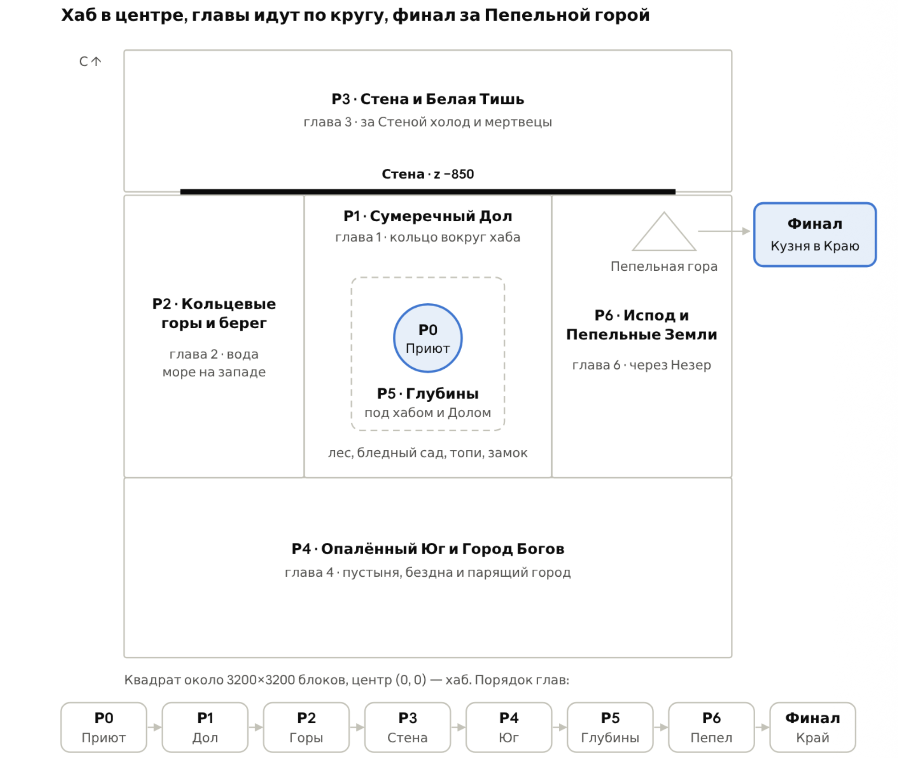

# The Last Ember — рамочный документ для Архитектора

Oct 18, 2026 · @Edward

## Как пользоваться

Штаб решает, какие локации нужны, где они стоят и какую роль играют. Архитектор решает, как они выглядят. Механику (датапак, ресурс-пак) делает отдельная сессия Claude Code, поэтому всё, что Архитектор строит, должно оставлять ей место: точки для триггеров, NPC, сундуков и пьедесталов.

Документ живой. Всё, что здесь не указано, Архитектор предлагает сам в карточке локации (формат в конце). Если идея Архитектора меняет роль локации или порядок прохождения, это вопрос к Штабу, а не решение.

**Зафиксированные решения**

| Тема | Решение |
| --- | --- |
| Версия | Minecraft Java 26.3 (Wilderness Bound), без модов: только датапак и ресурс-пак |
| Игроки | 2–3, кооператив |
| Структура | «Несущие Угли»: ноша через весь мир + алтарь в конце каждой главы + угасающий мир + финал с тремя концовками |
| Длительность | 20–30 часов на команду |
| Мир | Около 3000×3000 блоков: хаб в центре, 6 регионов-глав, финал |
| Смерть | Возрождение у последнего зажжённого костра. Остаются броня, вторая рука, предмет в главной руке, Уголь и ключевые предметы. Остальное падает в «пепельный след»: он не исчезает, светится, забрать его могут сам игрок и напарники. Если игрок снова погиб, не забрав след, или след оказался в лаве, пустоте, Чёрном озере, он уходит в Урну Утраченного у главного костра этого региона |
| Экономика | Жёсткая: вещи не пропадают навсегда, поэтому достаются тяжело. Лута мало, каждая находка ценна, уникальные вещи выдаются один раз |
| Костры | Зажечь костёр может только тот, кто несёт Уголь |

## Технические рамки

Карта должна держать стабильный FPS у слабого игрока при дальности прорисовки 12 чанков (около 190 блоков) без шейдеров и не перегружать сервер на трёх игроков. Шейдеры (Complementary Reimagined) только улучшают картинку: всё должно хорошо выглядеть и без них.

| Тема | Правило |
| --- | --- |
| Границы мира | Квадрат 3200×3200, центр (0, 0) — хаб. Играбельная зона около 3000×3000, по краям 100 блоков непроходимого рельефа |
| Высоты | y −64…320. Подземный регион (Глубины) занимает y −64…20, парящие скалы поднимаются до y 300 |
| Ориентиры | Главный ориентир региона виден от его входа, то есть не дальше 190 блоков. Из хаба дальние регионы не видны: Стена видна с северного края Дола, ориентиры остальных регионов — с их границ. Обзор всего мира даёт карта на Смотровой башне |
| Блоки | Только ванильные блоки 26.3. Ресурс-пак не перекрашивает блоки, потому что это изменит их во всём мире. Свои текстуры только у предметов, брони, частиц и интерфейса |
| Новые блоки 26.3 | Разрешены: тополь (листва красная, оранжевая, жёлтая), полочные грибы, красные кусты, подушки, соломенные кровати, ступени и плиты из шерсти и бетона. Точные ID Claude Code достанет из отчётов генератора данных игры 26.3 |
| Сущности | Не строить из сущностей. Стойки для брони, рамки, display-сущности: не больше 30 на чанк и 300 на регион. Мобов не больше 40 активных рядом с каждым игроком |
| Блочные сущности | Сундуки, бочки, вывески, баннеры, горшки — умеренно. Сундук с лутом ставится только там, где он отмечен в карточке. Декоративный сундук не должен выглядеть как лутовый |
| Редстоун | Только тот, что нужен загадке или ловушке. Никаких постоянных тактовых генераторов. Сложная логика уходит в датапак |
| Командные блоки | Не ставить. Вся логика в датапаке |
| Вода и лава | Без длинных текущих потоков и больших лавопадов рядом с важными зонами. Лава не соседствует с горючими блоками |
| Огонь | Горючие блоки (листва, дерево, шерсть, сено) держать вдали от лавы и от зон огненного дыхания драконов |
| Свет | Монстры появляются только при блочном свете 0. Тёмные зоны делаем намеренно, безопасные освещаем. В карточке отмечать, где тёмно и где светло |
| Свои биомы | Ставятся командой `fillbiome`, которая работает ячейками 4×4×4. Границы своего биома рисовать по сетке, кратной 4. Плавный переход — полоса 16–32 блока. В карточке давать контур зоны биома |
| Неразрушимые зоны | В них включается режим приключения. Архитектор указывает границы зоны (прямоугольник или цилиндр) и места, где нужен барьерный потолок. Неразрушимы: весь Приют, интерьеры всех подземелий и крепостей, Заколдованный замок, лабиринт, Город Богов, Чертоги и Безмолвный Город в Глубинах, Город Мертвенного Света, арены боссов, башни принцесс, алтари глав. Разрушаемы: дикая местность и шахты. Поверхность Кладбища Павших Рыцарей — тоже режим приключения: копать можно только «свежие могилы» и только лопатой. Каждый костёр — маленькая зона приключения радиусом 6 от очага. Внутри неразрушимых зон в декоре можно использовать медь, золото и другие ценные блоки |
| Шаблоны | Варианты для `clone` (лабиринт, «угасшие» версии мест, обрушения) хранятся в служебной зоне за играбельной областью. Координаты служебной зоны дадим отдельно |
| Рельеф | Предварительно: основа — сгенерированный мир 26.3 с подобранным сидом, затем ручная переделка. Ванильные структуры не используем как есть: нужные (храмы, испытания, древний город) переделываем под наш мир. Решено. Claude Code перебирает сиды ванильного генератора 26.3 и выбирает лучший под нашу карту. Проверка без участия Эдварда: карты высот и биомов сверху плюс скриншоты с заданных точек через бота. Архитектор даёт карты высот и эскизы только для ключевых форм (Кольцевая гора, Стена, каньон, вулкан, ледник), Claude Code лепит их скриптами |
| Ценные блоки | Экономика жёсткая. Вне неразрушимых зон не ставить в декор то, что можно добыть ради ресурсов: блоки железа, золота, алмазов, изумрудов и лазурита, много меди, маяки. Открытые жилы руды на поверхности — редко и намеренно. Внутри неразрушимых зон можно всё |
| Руда | Естественной руды в мире нет. Руда есть только в отмеченных шахтах, её запас конечный, объём задаёт Штаб. Архитектор не ставит руду в рельеф и декор вне шахт. При переделке сгенерированного рельефа руду вычищаем |
| Время суток | Идёт, обычный цикл дня и ночи. Он нужен для бессонницы, фантомов и нежити, которая горит на солнце. Вечные сумерки Приюта — только цвет неба своего биома |
| Солнце и луна | Ресурс-пак меняет текстуры во всём мире сразу: солнце — тусклый угасающий уголь, луна — красная. Сменить их только в одном биоме нельзя |
| Незер | Порталы не связаны по ванильному правилу 1:8. Вход в портал переносит игроков скриптом в заданную точку. Незер — ограниченная построенная область |
| Слои под Долом | Глубины занимают y −64…20 под хабом и Долом. Подземные постройки Р1 (склепы, шахты, логова) — не ниже y 30, между ними не меньше 10 блоков сплошной породы |

**Соломенная кровать (26.3)** пропускает ночь, не меняя точку возрождения. Это хорошо ложится на наши костры: в лагерях и у костров можно спать, не теряя чекпоинт. Обычные кровати в мире ставить только там, где это задумано.

## Сюжетная рамка и структура

Солнце мира погасло, от него остался последний Уголь. Игроки — Несущие: они проносят Уголь через шесть павших земель к Кузне Первого Пламени на краю мира. Это рабочая версия, имена и детали лора будут уточняться.

**Как это устроено**

- **Ноша.** Один игрок несёт Уголь. Передать его можно только у костра. Уголь нельзя потерять навсегда: если он упал в лаву или пустоту, он возвращается к последнему костру.
- **Костры.** Зажечь костёр может только носитель. Поэтому у каждого костра нужна площадка, к которой команда подходит вместе.
- **Главы.** Каждый регион — глава. Внутри главы 3–4 ключевые точки проходятся в любом порядке и дают ключевые предметы. Ключи ставятся на алтарь главы. Срабатывает событие, Уголь получает новое свойство, открывается путь в следующий регион.
- **Угасающий мир.** После каждой главы часть пройденных земель темнеет: меняется биом, гаснут второстепенные костры (носитель Угля может зажечь их снова), появляется больше элитных мобов. Для 1–2 ключевых мест каждого региона Архитектор готовит вторую, «угасшую» версию — она подменяет оригинал через `clone`.
- **Финал.** У Кузни три выбора, у каждого своя небольшая арена: разжечь солнце ценой носителя, погасить Уголь и освободить мёртвых, отдать Уголь тому, кто всю игру давал советы.

**Что это значит для построек**

- У каждого региона есть узнаваемый вход-ворота, которые до прохождения алтаря закрыты или непроходимы.
- У каждого региона есть шорткат обратно в хаб, который открывается изнутри региона.
- Алтарь главы — заметное место с пьедесталами или рамками под ключевые предметы и пространством для события: частицы, гром, свет, открывающийся проход.

**Лор, принятый по предложениям Архитектора**

- **Исполины — первые Несущие.** До людей ношу несли каменные гиганты. По главам видно, как они слабели: на юге атланты ещё держат Город Богов, у моря стоят колосс над гаванью и морские боги, у замка — колоссы-короли, на севере лежат кости и рука с мечом. Последний исполин уронил ношу, и она досталась людям.
- **Мечи павших Несущих.** Каждый меч в земле — могила отряда Несущих, который не дошёл. 2–4 меча на регион у мест их гибели: ориентиры, записки, эхо голосов. Это рифма к пепельному следу игроков.
- **Мир смотрит.** Лица в стволах, лица-скалы, головы под водой. За игроками наблюдает тот, кто даёт им советы. Намёки тонкие, раскрываются только в концовке «Отдать».
- **Советчик.** Старый маг с трубкой, живёт в Грибной роще в Р1. Позже появляется у главных костров других регионов.

**Народы и классы (для Зала Пробуждения)**

Выбираются свободно, любое сочетание. Предмет-символ народа держит статуя, символ класса лежит в чаше алтаря.

| Народ | Суть | Символ |
| --- | --- | --- |
| Люди Долин | Универсалы без слабых мест и без сильных сторон, удачливее в находках | Меч |
| Эльфы | Высокие, быстрые, прыгучие. Меньше здоровья, слабее в ближнем бою | Лук |
| Гномы | Низкие, крепкие, сильный удар, быстро копают. Медленные, плохо прыгают | Молот |
| Полурослики | Очень маленькие, тихие, ловкие, удачливые. Мало здоровья, короткая досягаемость | Трубка |
| Пеплорождённые | Люди, тронутые угасшим солнцем: крепче, почти не горят. Тяжелы в воде, святая вода их жжёт | Угасший светильник |

| Класс | Стиль | Символ |
| --- | --- | --- |
| Рыцарь | Щит, тяжёлая броня, ближний бой | Щит |
| Следопыт | Лук, разведка, ловушки, звери | Рог |
| Ворожей | «Заклинания»: заряды ветра, зачарования, книги | Посох |
| Алхимик | Зелья, яды, бросаемые склянки | Склянка |
| Пилигрим | Лечение и поддержка команды, хранитель огня | Фонарь |

## Карта мира

Приют стоит в центре, первая глава окружает его кольцом, следующие уходят на запад, север и юг, потом вниз под хаб и через Незер на восток. Схема показывает расположение и порядок, но не точные границы.

**Переходы между главами**

1. Р0 → Р1: открыто сразу, Дол начинается за стенами Приюта.
2. Р1 → Р2: Западный перевал расчищается после Алтаря I.
3. Р2 → Р3: Северные Врата Дозора открываются после Алтаря II. Дальше — Чёрный Пост и переход через Стену.
4. Р3 → Р4: после Алтаря III открывается Южный тракт из Приюта.
5. Р4 → Р5: после Алтаря IV землетрясение открывает Запечатанный колодец в хабе.
6. Р5 → Р6: Рамка Предков открывает портал в Незер, путь через Незер выводит в Пепельные Земли.
7. Р6 → Финал: звезда иссушителя открывает врата на вершине Пепельной горы.

Пройденные регионы остаются доступны через шорткаты, но по мере угасания мира становятся опаснее.

## Регионы

Масштаб в таблицах: **S** — до 40 блоков, **M** — 40–120, **L** — 120–300, **XL** — больше 300. Ориентиры по вайбу — это уровень и настроение, а не образец для копирования. Палитра блоков — отправная точка, Архитектор её расширяет.

### Р0. Приют Последнего Костра — хаб и пролог

**Где и сколько.** Центр мира, около 400×400, на холме над рекой. Безопасная зона: мобы почти не появляются.

**Атмосфера.** Последнее место, где ещё горит огонь. Вечные сумерки, тёплый свет костров и свечей посреди холодного мира. Усталые люди, закрытые ставни, колокол, который больше не звонит. Ориентир: Храм Огня из Dark Souls.

**Палитра.** Булыжник и замшелый булыжник, ель и тёмный дуб, черепица из глубинного сланца, окисленная медь, фонари, свечи, соломенные кровати и подушки в жилищах.

**Свой биом «Сумеречный Приют».** Небо тускло-янтарное к горизонту и сизое в зените. Туман тёплый серый. Трава и листва приглушённые оливковые. Вода тёмно-синяя. Естественный спавн монстров отключён: безопасность держится и на биоме, и на освещении.

**Учит.** Крафт, бой, костры, первая торговля, сон.

| Локация | Роль | Масштаб | Заметки |
| --- | --- | --- | --- |
| Зал Пробуждения | Старт, выбор расы и класса | M | Подземный храм под хабом: 5 ниш рас и 5 алтарей классов, выход наверх к костру |
| Главный Костёр и площадь | Хаб, сюда ведут шорткаты | S | Видно со всех улиц Приюта |
| Смотровая башня | Ориентир, обзор мира | S | Тонкая высокая башня на конусном холме, деревянные навесные галереи, наружная винтовая лестница. Наверху — карта мира из карт в рамках и подзорная труба |
| Доска заказов | Побочные квесты на чудовищ | S | У таверны |
| Кузница Приюта | Кузнечное дело, открытый торговец | S | Наковальня, точило, стол кузнеца |
| Урна Утраченного | Урна хаба и Сумеречного Дола. Сюда уходят пепельные следы, которые нельзя забрать: после повторной смерти, из лавы, пустоты, Чёрного озера | S | Рядом с Главным Костром |
| Ворота шорткатов | Короткий путь в каждый регион | S ×6 | Закрыты, пока шорткат не открыт изнутри региона |
| Запечатанный колодец | Вход в Глубины, открывается после главы 4 | M | Сначала — просто старый колодец с решёткой |

## Сквозные объекты

Эти объекты повторяются по всей карте. Для каждого Архитектор делает стандарт и 2–3 варианта под разные регионы.

**Костры-чекпоинты**

- Около 6–8 на регион, всего порядка 45.
- На основном пути — каждые 250–350 блоков или 10–15 минут игры. Всегда у входа в регион, у входа в подземелье, на каждом уровне Глубин и прямо перед дверью арены босса (снаружи).
- Стандарт: костёр в центре площадки примерно 7×7. Рядом безопасная точка возрождения 3×3: твёрдый пол, два блока воздуха над ней, светло. Видно состояние «не зажжён» и «горит».
- По возможности рядом место для соломенной кровати, чтобы спать, не сбивая чекпоинт.

**Урны Утраченного.** У главного костра каждого региона стоит Урна Утраченного (S). В неё уходят пепельные следы, которые нельзя забрать. Главный костёр региона не гаснет при угасании мира, его площадка и путь от шортката к нему остаются безопасными.

**Мечи павших Несущих.** 2–4 на регион, у мест гибели прошлых отрядов. Видны издалека, рядом записки. Это лор и ориентиры, а не тайники: лута у мечей нет или почти нет.

**Скрытые торговцы.** Найти торговца — само по себе приключение. Валюты и товары определит Штаб позже, Архитектору нужны место и вход.

| Торговец | Регион | Где |
| --- | --- | --- |
| Кузнец Приюта | Р0 | Открыто, в кузнице |
| Старьёвщица из Полого Дуба | Р1 | Внутри огромного мёртвого дерева в Пёстром лесу |
| Сокольничий | Р2 | Орлиное Гнездо |
| Рыбак из Гавани | Р2 | Грот под причалами Гниющей Гавани |
| Интендант Чёрного Поста | Р3 | Открыто, в крепости Дозора |
| Отшельник подо Льдом | Р3 | Пещера во льду, вход через замёрзшее озеро |
| Караванщик | Р4 | Засыпанный караван в дюнах |
| Гном-изгнанник | Р5 | Запечатанный зал в Шахтах Предков |
| Пепельный Монах | Р6 | Скит на склоне Пепельной горы |

**Башни принцесс.** Высокие одинокие башни с трудным подъёмом, ловушками, загадкой и стражем. Наверху покои принцессы и площадка для боя.

| Башня | Регион | Страж |
| --- | --- | --- |
| Башня Шипов | Р2, высший пик | Дракон |
| Башня Инея | Р3, ледяная скала | Гигантский фантом |
| Башня Миража | Р4, столовая гора | Гигантский гаст |

Для дракона нужны свободное небо вокруг башни (радиус около 100 блоков без высоких построек) и площадки, где огонь безопасен: камень, без горючих блоков.

**Банды разбойников.** Четыре банды кочуют по Р1–Р4. Постоянное логово есть только у главной банды, Красной Сотни, в Р4. Архитектору нужны: 3 шаблона временного лагеря (S), по 2–3 места для лагеря в каждом регионе, а также следы разбоя: сожжённые хутора, разорённые повозки, разграбленные стоянки.

**Ловушки и логова.** На основном пути каждого региона 3–5 ловушек и 1–2 логова. Логово — подземная полость около 30×30 под замаскированной ямой. Внутри останки и снаряжение прошлых жертв, записки и выход наверх, по которому могут спуститься напарники. Ловушки честные: у каждой есть видимая подсказка (странный блок, звук, частицы). Где именно ставить подсказку, Архитектор предлагает в карточке.

**Шорткаты.** У каждого региона есть короткий путь в хаб: дверь, подъёмник или тоннель, который открывается только изнутри региона.

## Формат карточки локации

Архитектор присылает по одной карточке на локацию. Все поля обязательны. Если поле не применимо, это пишется явно.

1. **Название и регион** — как в этом документе.
2. **Роль** — из таблицы региона, без изменений. Если предлагается другая роль, это отдельный вопрос к Штабу.
3. **Положение** — примерные координаты центра и связи с соседними локациями.
4. **Габариты** — ширина, длина, высота от и до по y.
5. **Образ** — атмосфера в 2–3 предложениях и ссылки на арты.
6. **Палитра блоков** — основные и акцентные блоки.
7. **Свой биом** — нужен ли, контур зоны, цвета неба, тумана, воды и травы, частицы.
8. **Свет** — где тёмные зоны со спавном мобов, где освещено.
9. **Точки для механик** — костёр, точка возрождения, NPC, сундуки с лутом, пьедесталы, нажимные плиты, триггер-зоны, места спавна мобов и босса.
10. **Пути** — вход, выход, шорткат, как не застрять. Для неразрушимых зон — их границы.
11. **«Угасшая» версия** — нужна ли и чем отличается.
12. **Нагрузка** — примерное число сущностей, блочных сущностей и редстоуна.
13. **Открытые вопросы** к Штабу.

## Журнал изменений

| Версия | Дата | Что изменилось |
| --- | --- | --- |
| 0.7 | 19.10.2026 | Народы и классы. Каждый костёр — зона приключения радиусом 6. По карточкам Р0 (партия 1) |
| 0.6 | 19.10.2026 | Рельеф решён: перебор сидов и проверка без участия Эдварда. По карточкам Р1 (партия 1): алтари глав неразрушимы, поверхность кладбища в режиме приключения, биом «Сон Замка» |
| 0.5 | 19.10.2026 | Название The Last Ember. Ответы на вопросы Архитектора: видимость ориентиров, неразрушимые зоны, время суток, солнце и луна, Незер, слои под Долом, колоссы. Принят лор исполинов, мечей павших Несущих и Советчика |
| 0.4 | 18.10.2026 | Урна Утраченного в каждом регионе у главного костра, который не гаснет при угасании мира |
| 0.3 | 18.10.2026 | Руда только в отведённых шахтах с конечным запасом, шахты добавлены в регионы 1, 2, 4, 5 |
| 0.2 | 18.10.2026 | Уточнено правило смерти (пепельный след, Урна Утраченного), экономика жёсткая, добавлено правило о ценных блоках в декоре |
| 0.1 | 18.10.2026 | Первая версия: структура «Несущие Угли», 6 регионов, хаб и финал, технические рамки, сквозные объекты, формат карточки |

### Р1. Сумеречный Дол — глава 1

**Где и сколько.** Кольцо низин вокруг Приюта, примерно от 200 до 650 блоков от центра. Больше всего места — на севере, юге и востоке от хаба.

**Атмосфера.** Бывшее сердце королевства, застывшее в вечной осени. Красно-жёлтые тополя, белёсый бледный сад, болота в тумане, курганы и заколдованный замок. Здесь мир впервые показывает, что сошёл с ума. Ориентиры: Лихолесье, Запретный лес, Кривоуховы топи, кладбище из Bloodborne.

**Биомы.** Пёстрый лес (ванильный, 26.3), бледный сад (ванильный), тёмный лес, болото и мангры.

**Свои биомы.**

- *«Плачущий Дол»* (основа региона): небо серо-сизое, туман молочный и плотный вблизи, трава охристая, вода серо-зелёная.
- *«Курганы»* (кладбище): туман бледный и очень плотный, небо серо-зелёное, частицы — белый пепел и редкие огоньки душ.
- *«Кривые Топи»*: вода мутно-зелёная, туман болотно-зелёный, небо желтовато-серое, частицы — споры.

**Палитра.** Тополь трёх цветов листвы, бледный дуб и бледный мох, тёмный дуб, замшелый булыжник, туф и кальцит для надгробий, плитка из глубинного сланца для склепов, железные решётки, свечи, паутина.

**Учит.** Броня от кожи до железа, щиты и луки, первое зачарование, торговля. Здесь же первые банды разбойников.

**Угрозы.** Зомби, скелеты, пауки (элитные паучихи в лесу), ведьмы, слизни, болотники, скрипуны в бледном саду, фантомы.

| Локация | Роль | Масштаб | Заметки |
| --- | --- | --- | --- |
| Кладбище Павших Рыцарей | Раскопки проклятого лута, духи-стражи | L | Около 150×150, склепы, туман |
| Сторожка смотрителя | NPC и квест, награда — печать | S | На краю кладбища |
| Заколдованный замок и Колоссы | Подземелье и босс главы, ключевой предмет | L | Около 200×200 вместе с лестницей. Два колосса-статуи 40–60 блоков высотой, это не боссы: «пробуждение» делает датапак. В глазницах ниши 2×2 под смену блоков для свечения. Свой биом «Сон Замка» в контуре зоны, у подножия лестницы озеро или река. Неразрушимая зона |
| Заколдованный лабиринт | Испытание, ключевой предмет в центре | L | Около 120×120, изгороди не ниже 5 блоков. 5–6 участков 24×24, которые перестраиваются из шаблонов |
| Сад Безмолвия (бледный сад) | Биомная награда — Скрипучая броня, ключевой предмет | L | Скрипуны, сердца скрипунов |
| Кривые Топи и Хижина Трёх Ведьм | Квест у ведьм, ключевой предмет | L, хижина M | Хижина на сваях, лодочные протоки |
| Деревня Вереск | Проклятая деревня, где мир сошёл с ума | M | Жители-зомби, записки, побочный квест |
| Паучья чаща в Пёстром лесу | Логово элитных пауков | M | Паутина, коконы, останки |
| Следы банд | Окружение | S ×4–6 | Сожжённые хутора, разорённые повозки, заброшенные лагеря |
| Круг Плакальщиц | Алтарь I | M | Круг статуй вокруг мёртвого дерева, пьедесталы под ключи |
| Западный перевал | Ворота в регион 2 | M | Завален, пока не пройден Алтарь I |
| Шахты Железных Руд | Уголь и железо, конечный запас | M | Заброшенная выработка: мертвецы, обвалы, рельсы |
| Грибная роща Советчика | Дом Советчика, сюжетный NPC | M | Старый маг с трубкой. Гигантские грибы, полочные грибы на тополях, едва заметные лица в стволах |

### Р2. Кольцевые горы и Туманный берег — глава 2

**Где и сколько.** Запад, примерно от x −650 до края мира. Горы переходят в скалистый берег и море с островом в тумане.

**Атмосфера.** Глава о воде: живой и мёртвой. Высокие горы, внутри которых спрятан светлый островок мира, и глубокие пещеры с чёрным озером. На берегу — гниющий порт и остров, вечно скрытый туманом. Ориентиры: пещера с отравленным озером, Остров туманов, Орлиное Гнездо.

**Биомы.** Зазубренные и заснеженные пики, каменистые склоны, рощи, пышные пещеры, глубокий и холодный океан, каменистый берег.

**Свои биомы.**

- *«Долина Исцеления»*: вода бирюзово-серебристая, небо светлое жемчужное, туман серебристый, над водой частицы-искры. Единственное светлое место в регионе.
- *«Ядовитые Пещеры»*: туман ядовито-зелёный, частицы — споры, звуки капель.
- *«Чёрное Озеро»*: вода почти чёрная, подводный туман чёрно-зелёный, редкие тусклые частицы.
- *«Остров Туманов»*: туман белый и очень плотный, небо белёсое, вода серая.

**Палитра.** Камень, андезит, кальцит и туф для гор, снег и лёд на пиках, азалия, мох и светящиеся ягоды в пещерах, призмарин и тёмный призмарин в затонувшем храме, гнилое дерево гавани — ель, тёмный дуб, паутина, железные решётки.

**Учит.** Зельеварение (главная механика главы), дыхание под водой, бой под водой, трезубцы.

**Угрозы.** Утопленники, стражи и древний страж, пещерные пауки, ведьмы, болотники, чешуйницы в шахтах, фантомы над пиками, элитные мобы в зачарованном снаряжении в пещерах. Страж башни — дракон.

| Локация | Роль | Масштаб | Заметки |
| --- | --- | --- | --- |
| Кольцевая гора | Ориентир, оболочка долины | XL | Кольцо около 400 в диаметре, пики до y 250. Озеро видно с гребня |
| Долина и Исцеляющее озеро | Безопасная зона, святая вода | L | Озеро около 80 в поперечнике, руины святилища на берегу |
| Три пути в долину | Перевал, тайный туннель, опасный подъём | S–M | Каждый путь — своё мини-испытание |
| Ядовитые пещеры | Подземелье с ценным лутом | L | У внутреннего подножия, 2–3 уровня |
| Чёрное озеро | Испытание переправы, ключевой предмет | M | Пещера около 80×80, островок в центре, место для лодки или скрытого моста |
| Чаша Двух Вод | Алтарь II | M | Уступ над Исцеляющим озером |
| Гниющая Гавань | Мёртвый порт, побочные квесты | M–L | Утопленники, затопленные склады |
| Остров Туманов и Затонувший храм | Подземелье, древний страж, ключевой предмет | L | Ванильный подводный храм, переделанный под наш мир |
| Орлиное Гнездо | Скрытый торговец | M | Крепость на скале над пропастью, вход только по узкому мосту |
| Шахта с чешуйницами | Медь и немного железа, ловушка, короткий путь | M | Заражённый камень как предупреждение |
| Башня Шипов | Башня принцессы, страж — дракон | M | На самом высоком пике региона |
| Северные Врата Дозора | Ворота в регион 3 | M | Дорога к Стене открывается после Алтаря II |

### Р3. Стена и Белая Тишь — глава 3

**Где и сколько.** Север. Стена стоит примерно на z −850 между двумя непроходимыми горными хребтами. За ней до северного края мира тянутся замёрзшие земли.

**Атмосфера.** До Стены — последний форпост живых, за ней — мёртвая белизна, тишина и холод, который убивает. Переход через Стену — отдельное событие: дальше дороги назад почти нет. Ориентиры: Стена и земли за ней, Тропа Мёртвых, ледяной город из Dark Souls, Ледяная Корона.

**Биомы.** Заснеженная тайга, ледяные шипы, рощи, замёрзший океан и реки, заснеженные склоны.

**Свои биомы.**

- *«Белая Тишь»*: небо стальное, туман белый и плотный, снег идёт почти всегда, вода тёмно-синяя подо льдом, звук ветра.
- *«Тропа Мёртвых»* (ущелье): туман сине-серый, частицы — души, мертвенно-синий свет.
- *«Ледяная Корона»* (ледник): небо почти чёрное, туман ледяной голубой, частицы — снежинки и белые искры.

**Палитра.** Плотный и синий лёд, снег, рыхлый снег (ловушки), глубинный сланец и чернокамень для крепости Дозора, ель и тёмный дуб, цепи, фонари душ, кости.

**Учит.** Выживание в холоде (рыхлый снег, кожаные ботинки, тепло костров), дальний бой, рыхлый снег как ловушка, приручение волков.

**Угрозы.** Зимогоры, ледяные зомби в морозной броне, волки, белые медведи, фантомы, чешуйницы во льду, оживающие статуи на Тропе Мёртвых. Страж башни — гигантский фантом.

| Локация | Роль | Масштаб | Заметки |
| --- | --- | --- | --- |
| Стена | Главный ориентир, событие перехода | XL | Видимая часть около 700 в длину, около 150 в высоту, около 40 в толщину. Видна из хаба |
| Чёрный Пост | Последний форпост живых, торговец, костёр | L | Крепость Дозора у южного подножия Стены |
| Врата через Стену | Событие перехода | M | Тоннель сквозь лёд или подъёмник с лестницами на гребень и спуск |
| Белая Тишь | Замёрзшие леса с мертвецами | XL | Основная территория главы |
| Иней-на-Холме | Заброшенный ледяной город, подземелье | L | Ключевой предмет |
| Тропа Мёртвых | Ущелье со статуями-призраками | L | Оживающие статуи, ключевой предмет |
| Лагеря разведчиков | Окружение, лор, мелкий лут | S ×4–6 | Заброшенные лагеря из 26.3, переделанные под Дозор |
| Круг Обелисков | Алтарь III | M | Кольцо обелисков в ледяных горах, место для грозы и свечения |
| Ледяная Корона | Трон мёртвого короля, босс главы | L, арена M | Ледник на северном краю мира, ключевой предмет |
| Башня Инея | Башня принцессы, страж — гигантский фантом | M | Отдельная ледяная скала |

### Р4. Опалённый Юг и Город Богов — глава 4

**Где и сколько.** Юг, примерно от z +650 до края мира. Пустыня и бесплодные земли обрываются в бездонный каньон, над которым парит город богов.

**Атмосфера.** Здесь солнце погасло первым. Выжженные дюны, погребённые храмы, руины первой цивилизации, а над бездной в тумане — огромный город на парящих скалах, связанных цепями и мостами. Это главное «вау» карты. Ориентиры: Анор Лондо, парящие скалы Аватара в мрачном ключе.

**Биомы.** Пустыня, бесплодные земли и плато, саванна на окраинах.

**Свои биомы.**

- *«Багровые Дюны»*: небо выгоревшее, белёсо-жёлтое, туман охристый, частицы — пыль, вода редкая и мутная.
- *«Разбитое Небо»* (каньон и парящие скалы): небо тёмное, лиловато-серое, туман густой лиловато-серый снизу, частицы — белый пепел, звук ветра.
- *«Город Богов»*: небо холодное золотое, туман светлый, частицы — редкие золотые искры. Мёртвый, но всё ещё величественный.

**Палитра.** Песчаник и красный песчаник, терракота, глина, кальцит и кварц для города богов, золото и медь для украшений, цепи, лианы, подмости для канатных переходов, туф и медь для испытательных камер.

**Учит.** Археология (кисть, черепки, шаблоны отделки брони), испытательные камеры, заряды ветра, булава, элитры как награда за город.

**Угрозы.** Кадавры, иссохшие скелеты, пауки, вихри в испытаниях, элитный вихрь-босс, гаст над пустыней. Главная банда разбойников. Страж башни — гигантский гаст.

| Локация | Роль | Масштаб | Заметки |
| --- | --- | --- | --- |
| Багровые Дюны | Основная территория | XL | Миражи, полузасыпанные статуи |
| Погребённый храм | Подземелье с ловушками | M | Переделанный ванильный пустынный храм |
| Руины Первого Города | Археологический раскоп, лор | L | Подозрительный песок и гравий, ключевой предмет |
| Испытания Богов | Испытательные камеры | L | 1–2 ванильные испытательные камеры, переделанные под наш мир, ключевой предмет |
| Лагерь Красной Сотни | Логово главной банды | M | На плато бесплодных земель |
| Бездна «Разбитое Небо» | Каньон без дна, путь к городу | XL | Цепи, канатные мосты, точки для зарядов ветра |
| Город Богов | Главная локация главы, пройти насквозь | XL | Парящие скалы до y 300. Самая большая постройка на карте |
| Престол Рассвета | Алтарь IV и арена босса | M | На вершине города |
| Башня Миража | Башня принцессы, страж — гигантский гаст | M | На отдельной столовой горе |
| Погребённые выработки | Золото, конечный запас | M | Засыпанные штольни под дюнами |

Событие Алтаря IV — землетрясение, после которого в хабе открывается Запечатанный колодец.

### Р5. Глубины — глава 5

**Где и сколько.** Под Приютом и Сумеречным Долом, y −64…20, около 800×800. Вход — Запечатанный колодец в хабе. Спуск идёт уровнями, каждый страшнее предыдущего.

**Атмосфера.** Самая большая опасность всё время была у игроков под ногами. Гномье царство, разбуженное слишком глубоким копанием, мост над пропастью, подземная река под звёздами из светящихся камней и, на дне, древний город, где спит то, что нельзя будить. Ориентиры: Мория и мост, подземная река под звёздным небом.

**Уровни.**

1. *Шахты Предков*: шахты, рельсы, руда, кузни гномов.
2. *Чертоги и Мост*: огромные залы с колоннами, узкий мост над пропастью.
3. *Звёздная Река*: подземная река в огромной полости, на потолке «звёзды».
4. *Безмолвный Город*: глубокая тьма и древний город. Его ванильная рамка-портал — Алтарь V.

**Свои биомы.**

- *«Чертоги»*: туман тёплый бурый, частицы — пыль и редкие искры.
- *«Звёздная Река»*: вода тёмно-синяя со свечением, туман глубокий синий, частицы — медленные светящиеся точки.
- Глубокая тьма остаётся ванильной.

**Палитра.** Глубинный сланец во всех видах, чернокамень, медь разных стадий, железные решётки, цепи, лава в кузнях, светокамень, лишайник и морские фонари для «звёзд», скалк.

**Учит.** Добыча руды, скрытность (скалк, шерсть, тихие шаги), кузнечное дело и улучшение до незерита, компас восстановления.

**Угрозы.** Мёртвые гномы (зомби малого роста в доспехах), скелеты, пещерные пауки, чешуйницы, слизни, криперы, хранитель.

| Локация | Роль | Масштаб | Заметки |
| --- | --- | --- | --- |
| Шахты Предков | Главный рудник карты: железо, золото, редстоун, немного лазурита, алмазы в самых глубоких штольнях | L | Рельсовые пути, вагонетки |
| Изгнанник в запечатанном зале | Скрытый торговец | S | Гном-изгнанник |
| Чертоги и Мост | Главная сцена главы | L | Мост длиной 60–80 блоков над пропастью, побег по нему |
| Звёздная Река | Самое красивое место Глубин, путь на лодке | L | Тихая передышка между ужасами |
| Безмолвный Город | Хранитель, ключевой предмет | L | Переделанный ванильный древний город |
| Рамка Предков | Алтарь V | M | Рамка древнего города открывает портал в Незер |
| Шорткат в хаб | Короткий путь наверх | S | Подъёмник или винтовая лестница |

### Р6. Испод и Пепельные Земли — глава 6

**Где и сколько.** Незер (Испод) плюс восток верхнего мира, примерно от x +650 до края. Портал из Глубин ведёт в Незер. Путь через Незер выводит к порталу в Пепельных Землях.

**Атмосфера.** Земля, где погасшее солнце упало и прогорело. Пепел вместо снега, мёртвые топи с огнями под водой, город мертвенного света и вулкан на горизонте, который виден из любой точки региона. Ориентиры: Мордор и Роковая гора, Мёртвые топи, Минас-Моргул, Харренхолл для крепости Незера.

**Незер (Испод).** Ванильные биомы Незера, переделанная крепость (огненные духи, иссушённые скелеты) и бастион (пиглины, бартер). Здесь призывают иссушителя.

**Свои биомы верхнего мира.**

- *«Пепельная Пустошь»*: небо красно-бурое, туман пепельно-серый и плотный, частицы — пепел, вода серая. Почти без травы.
- *«Мёртвые Топи»*: вода чёрная, подводный туман тёмный, под водой бледные огоньки душ и «лица» из черепов и голов.
- *«Город Мертвенного Света»*: небо почти чёрное, туман зеленовато-серый, частицы — зелёные искры, свет от огня душ.

**Палитра.** Чернокамень, базальт, туф, магма, вулканический пепел (серый бетонный порошок), обсидиан и плачущий обсидиан, огонь душ и фонари душ, кости, тёмный призмарин для призрачного зелёного.

**Учит.** Путешествие по Незеру, бартер с пиглинами, огнестойкость, маяк, незерит.

**Угрозы.** Иссушённые скелеты, огненные духи, пиглины и брутальные пиглины, гасты, лавовые кубы, хоглины и зоглины, иссушитель. Наверху — элитная нежить и ведьмы.

| Локация | Роль | Масштаб | Заметки |
| --- | --- | --- | --- |
| Огненная Крепость | Подземелье в Незере | L | Переделанная крепость Незера |
| Бастион Свиных Королей | Бартер, ценный лут, ключевой предмет | L | Переделанный бастион |
| Наковальня Трёх Глав | Арена призыва иссушителя, Алтарь VI | M | Звезда иссушителя — ключ к финалу |
| Пепельная Пустошь | Основная территория | XL | Вулкан всегда в поле зрения |
| Мёртвые Топи | Переход с опасной водой | L | Узкие гати |
| Город Мертвенного Света | Последняя крепость врага | L | Ключевой предмет |
| Пепельная гора | Ориентир, финальное восхождение | XL | Вулкан в восточном углу карты, на вершине — врата в Край |

### Финал. Кузня Первого Пламени

**Где.** Край, отстроенный заново. Портал на вершине Пепельной горы ведёт на остров Края.

**Атмосфера.** Пустота за краем мира. Остров, где когда-то ковали солнце: столпы, разрушенная кузня в центре, чёрное небо без звёзд.

**Состав.** Бой с драконом Края, затем Кузня и выбор. Три небольшие арены концовок (каждая M): «Разжечь», «Погасить», «Отдать». Небольшой разрушенный город Края как необязательный эпилог с шалкерами.
