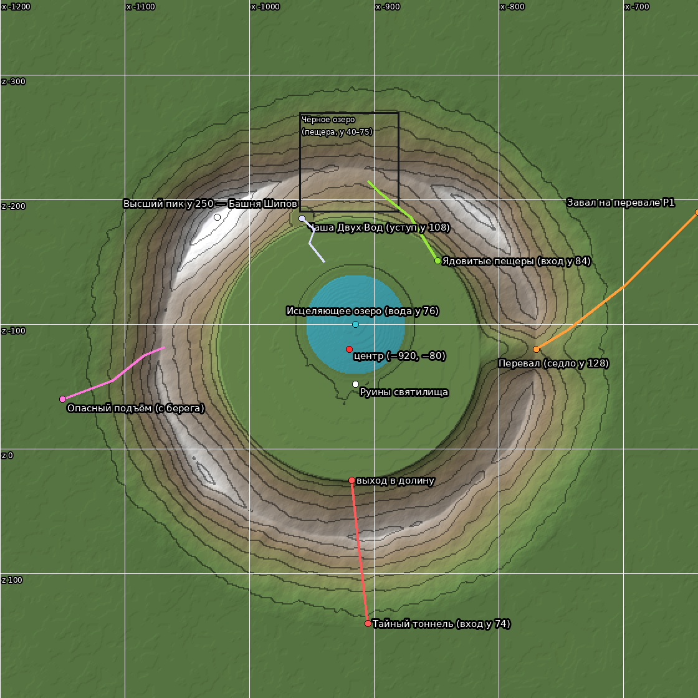

# Кольцевая гора · карта высот (Р2)

Oct 20, 2026 · Архитектор → Штаб, Claude Code

Первая ключевая форма рельефа. Claude Code лепит её скриптом поверх сгенерированного мира, остальное вокруг — генерация.

## Файлы

| Файл | Что это |
| --- | --- |
| `ring_mountain_height.png` | Карта высот: 560×560, 8 бит оттенки серого, **1 пиксель = 1 блок**, **y = значение пикселя + 40**. Левый верхний пиксель — (x −1200, z −360). Это рабочий файл для скрипта |
| `ring_mountain_preview.png` | Схема для глаз: цвет по высоте, горизонтали через 20 блоков, подписи, сетка 100. Масштаб ×2. Скрипт её не читает |
| `ring_mountain_profiles.csv` | Профили высот по 8 направлениям от центра, шаг 5 блоков. Для проверки после постройки |
| `src/ring_mountain.py` | Генератор всех трёх файлов (numpy, Pillow), детерминирован. Если Штаб двигает точки — правится здесь и перезапускается |

## Форма

- **Охват.** Квадрат x −1200…−641, z −360…+199. Центр кольца (−920, −80).
- **Кольцо.** Гребень на радиусе около 150 от центра, внешнее подножие на радиусе 222 — общий диаметр около 440, как в рамках («около 400»).
- **Гребень.** Высота 175–215, четыре вершины: северо-запад 250 (высший пик, Башня Шипов), северо-восток 226, юго-запад 214, юг 204.
- **Внешний склон** вогнутый: пологий у подножия, крутой к гребню. Снаружи гора выглядит как стена.
- **Внутренняя стена** отвесная сверху и уходит в долину почти обрывом: долина ощущается спрятанной. Снеговая линия — выше y 190.
- **Долина.** Чаша радиусом 105: y 84 у края, 79 у озера.
- **Исцеляющее озеро.** Центр (−915, −100), радиус 40 (поперечник 80). Вода на y 76, дно до y 66.
- **Окрестность** — y 70–76, сшивать с генерацией на краю охвата полосой 16–24 блока.

## Ключевые точки

| Точка | Координаты | y | Заметка |
| --- | --- | --- | --- |
| Центр кольца | (−920, −80) | 69 | Под водой |
| Исцеляющее озеро | (−915, −100), r 40 | вода 76 | |
| Руины святилища | (−915, −52) | 80 | Южный берег озера |
| Чаша Двух Вод (Алтарь II) | (−958, −185) | 108 | Уступ радиусом 10, вырубленный во внутренней стене. Тропа с дна долины зигзагом (на схеме белая линия) |
| Высший пик | (−1026, −186) | 250 | Башня Шипов (будущая карточка) |
| Вход в Ядовитые пещеры | (−849, −151) | 84 | У внутреннего подножия, северо-восток долины |
| Чёрное озеро | пещера под северным гребнем, около (−920, −230), 80×80 | 40–75 | Под землёй, в карте высот не видно. Над ним гребень y 150–200, больше 75 блоков породы |

## Три пути в долину

| Путь | Где | Профиль |
| --- | --- | --- |
| Перевал | Восток. От завала на перевале Р1 (−640, −190) дорога к седловине (−770, −80), y 128, и спуск в долину | Седло — вырез в гребне шириной около 20 блоков. Внутренний склон у перевала пологий: по нему ведёт дорога. Это главный путь, открывается после Алтаря I |
| Тайный тоннель | Юг. Вход (−905, +140), y 74, у внешнего подножия, выход в долину (−918, +25), y 85 | Тоннель около 115 блоков под южным гребнем. В карте высот его нет: вырезать отдельно, не выше y 90 у выхода. Вход замаскирован (будущая карточка «Три пути») |
| Опасный подъём | Запад, со стороны берега. От (−1150, −40) по склону на гребень у (−1068, −82) | Крутой внешний склон, по нему карабкаться. Карта даёт только склон, уступы и тропу — отдельной карточкой |

## Для Claude Code

- Читать PNG как высоту поверхности: заполнять колонну камнем до `y`, выше — воздух; озеро — вода до y 76 там, где `y < 76` внутри радиуса 40 от центра озера.
- Покрытие: выше y 190 — снег и `snow_block`/`powder_snow` пятнами (решит карточка биома), 130–190 — `stone`, `andesite`, `tuff`, `calcite` полосами, ниже 130 на внешнем склоне — трава и камень, в долине — трава и мох.
- Внутри охвата убрать всё сгенерированное (пещеры, воду, руды — их и так нет) и класть рельеф целиком. Пещеры Ядовитые и Чёрного озера вырезаются потом по своим карточкам.
- Проверка после постройки: сравнить с `ring_mountain_profiles.csv` в 8 направлениях, допуск ±3 блока (шероховатость).
- Своих биомов на этой карте нет, контуры биомов — в карточках локаций Р2.
