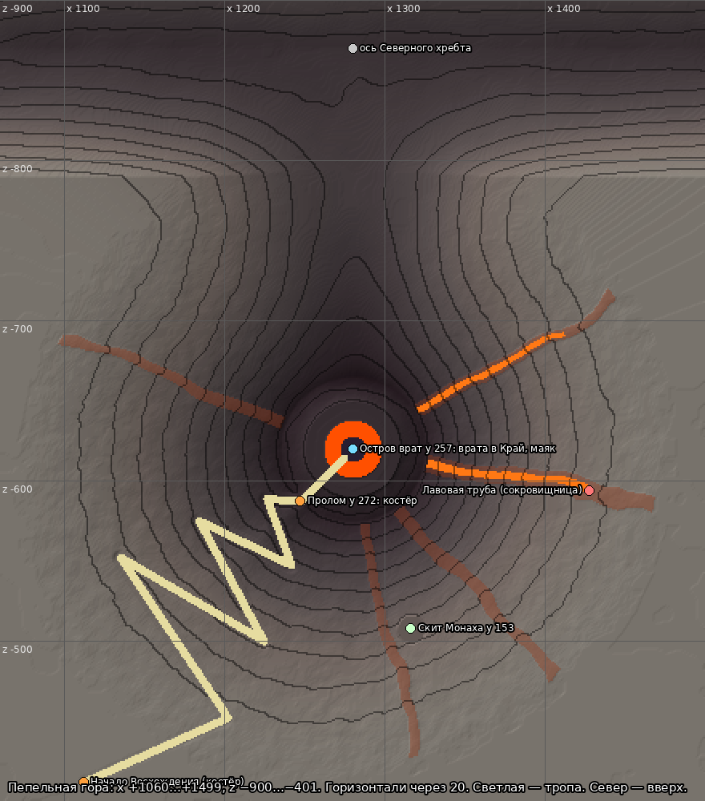

# Пепельная гора · карта высот (Р6)

Oct 21, 2026 · Архитектор → Штаб, Claude Code

Четвёртая ключевая форма — вулкан в северо-восточном углу Р6, прижатый к Северному хребту. Формат тот же, что у Кольцевой горы и Стены: **y = значение + 40**.

## Файлы

| Файл | Что это |
| --- | --- |
| `ash_mountain_height.png` | 440×500, 8 бит, **1 пиксель = 1 блок**, **y = значение + 40** (0 → 40, 255 → 295). Левый верхний пиксель — (x +1060, z −900) |
| `ash_mountain_material.png` | Карта материалов, тот же охват (легенда ниже) |
| `ash_mountain_preview.png` | Схема для глаз: высоты, горизонтали через 20, тропа, точки. Масштаб ×2 |
| `ash_mountain_profiles.csv` | Профили по 8 направлениям от центра, шаг 5 |
| `src/ash_mountain.py` | Генератор, детерминирован (seed 2066) |

## Форма

- **Охват.** x +1060…+1499, z −900…−401. Центр (+1280, −620). Восточный край — край мира (барьер, рамки).
- **Конус.** Подножие на радиусе около 200 (на юго-запад, к Городу, — до 225: склон длиннее и положе), окрестность y 80. Склон вогнутый: пологий внизу, крутой к гребню.
- **Гребень кратера** на радиусе 45: y 280–288, северный пик **294**. На юго-западе — **Пролом**, вырез в гребне до y 271: сюда приходит тропа.
- **Кратер.** Внутренняя стена с гребня до дна, дно y 256 на радиусе до 30. В центре — **лавовое озеро** r 18, лава на y 253. Посреди озера — **Остров врат** r 8, y 257: врата в Край и пирамида маяка.
- **Седловина и хребет.** Северный склон не опускается в долину, а седловиной y 225–260 переходит в Северный хребет (ось z −870, гребень y 240–260, южное подножие z −790 — как в «Стене»). Вулкан — часть стены мира: с севера к нему не подойти.
- **Лавовые потоки.** Пять радиальных ложбин глубиной 2–4: на 60°, 100°, 140°, 170°, 290° (азимут, 0 — север). Два (60° и 100°, восточные) — живые: лава в середине ложбины ниже r 150. Остальные — застывшие: магма и базальт.
- **Тропа Восхождения.** Серпантин по юго-западному склону от подножия (+1112, −412), y 80, до Пролома (+1247, −587), y 271. 7 колен, длина около 536, полотно 5, плечи сглажены. В Проломе — пандус вниз на дно кратера и дамба через лаву к Острову врат (около 38).

## Ключевые точки

| Точка | Координаты | y | Заметка |
| --- | --- | --- | --- |
| Начало Восхождения | (+1112, −412) | 80 | Костёр, в 135 от Задних ворот Города |
| Полка | (+1224, −500) | 144 | Конец 3-го колена. Костёр. Отсюда тайная тропа к Скиту |
| Скит Пепельного Монаха | (+1316, −508) | 153 | Терраса r 9 на южном отроге, за застывшим потоком 170° |
| Лавовая труба | (+1428, −594) | ~105 | Вход в сокровищницу у живого потока 100° |
| Пролом | (+1247, −587) | 271 | Костёр. Меч павших Несущих в 12 ниже по тропе |
| Остров врат | (+1280, −620), r 8 | 257 | Врата в Край, пирамида маяка |
| Северный пик | азимут ~10°, r 45 | 294 | Высшая точка карты на поверхности |

## Материалы (`ash_mountain_material.png`)

| Цвет | Что | Блоки |
| --- | --- | --- |
| серый (150,145,140) | нижние склоны, пепел | как Пустошь: `gray_concrete_powder`, `light_gray_concrete_powder`, `tuff`, `gravel` |
| тёмно-серый (70,68,72) | верхние склоны, выше y 180 | `basalt` 40%, `smooth_basalt` 25%, `blackstone` 20%, `tuff` 15% |
| почти чёрный (35,30,35) | хребет | `blackstone` 50%, `basalt` 30%, `tuff` 20% (как Обугленный хребет) |
| ржавый (150,60,30) | застывший поток | `magma_block` 35%, `basalt` 35%, `blackstone` 30% |
| оранжевый (255,120,20) | живой поток | `lava` в русле шириной 2–3, по краю `magma_block` |
| лиловый (40,20,60) | стена и дно кратера | `obsidian` 40%, `crying_obsidian` 15%, `blackstone` 25%, `basalt` 20% |
| красно-оранжевый (255,80,0) | лавовое озеро | `lava` до y 253 |
| песочный (230,220,160) | тропа, пандус, дамба | `polished_blackstone`, `blackstone_slab` ступени, `coarse_dirt` под пеплом внизу |
| голубой (120,220,255) | Остров врат | по карточке (Р6, партия 4) |

## Для Claude Code

- Заполнять колонну до `y`, выше — воздух; лава — до y 253 в озере и по маске живых потоков.
- Внутри охвата убрать генерацию целиком (пещеры, воду) и класть рельеф; по краю сшить полосой 16–24 с Пустошью. Север (z < −790) — Северный хребет, сшить с его продолжением на запад.
- Лавовая труба (сокровищница) — вырезать отдельно по карточке, в карте высот только вход.
- Проверка — по профилям, допуск ±3 на склонах, ±1 на тропе и в кратере.
- Огонь от лавы не распространяется (`fire_spread_radius_around_player 0`, T-004) — склоны без травы, но проверить пепел-порошок у живых потоков.
