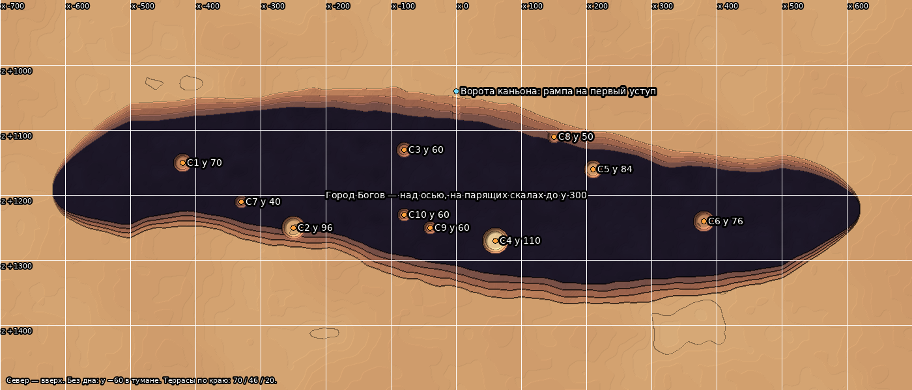

# Бездна «Разбитое Небо» · карта высот (Р4)

Oct 20, 2026 · Архитектор → Штаб, Claude Code

Третья ключевая форма — каньон без дна под Городом Богов. Формат тот же, что у Кольцевой горы и Стены, но **смещение по высоте другое**: каньон уходит ниже нуля.

Ржавый Разлом (граница Р1, Р2, Р6 с Р4) укладывается в описание из «Границ регионов» — однородный каньон 30–50 в ширину вдоль оси z +650. Отдельной карты высот ему не нужно: скрипт строит его по оси и ширине.

## Файлы

| Файл | Что это |
| --- | --- |
| `broken_sky_height.png` | 1400×600, 8 бит, **1 пиксель = 1 блок**, **y = значение − 64** (0 → y −64, 156 → y 92). Левый верхний пиксель — (x −700, z +900) |
| `broken_sky_preview.png` | Схема: цвет по высоте, горизонтали через 20, столпы С1–С8, ворота каньона |
| `broken_sky_profiles.csv` | Профили с севера на юг на 9 долготах, шаг 10 |
| `src/broken_sky.py` | Генератор, детерминирован |

## Форма

- **Плато пустыни** вокруг: y 86–98.
- **Каньон.** Ось извивается около z +1200, длина около 1240 (x −620…+620), ширина 230–360. К концам по x сужается и закрывается.
- **Края — три террасы:** y 70, 46, 20. Каждая — узкий карниз 10–20 блоков. С них видно, как стены уходят в туман. На террасах — тропы, остатки мостов, точки для зарядов ветра (карточка Бездны).
- **Дно** — y −60…−56. Его не видно: туман биома «Разбитое Небо» снизу густой. Для игрока это «без дна», для правила пепельного следа — пустота.
- **Столпы С1–С10** — скальные пальцы из бездны, вершины y 40–110. На них держатся цепи и мосты к парящим скалам Города и стоят атланты (координаты в схеме и в карточках Бездны и Города). С9 (−40, +1250) и С10 (−80, +1230), вершины y 60, добавлены 21.10 — под Мост исполинов.
- **Ворота каньона.** Рампа шириной 12 у (0, +1040): с плато на первую террасу y 20 на северной стене. Отсюда начинается путь к Городу.

## Для Claude Code

- Вырезать по PNG: всё ниже значения — камень, выше — воздух. Дно y −60: ниже y −64 нет мира, так что внизу 4 блока породы.
- Слои стен: сверху 30 блоков `red_sandstone`, `terracotta` разных цветов полосами (бесплодные земли), ниже — `stone`, `tuff`, `deepslate` к низу. Детали — в карточке Бездны.
- Глубины (Р5) лежат под хабом и Долом, z до +400. Каньон начинается с z +1000 — не пересекаются.
- Проверка — по профилям, допуск ±4 на стенах, ±1 на террасах.
