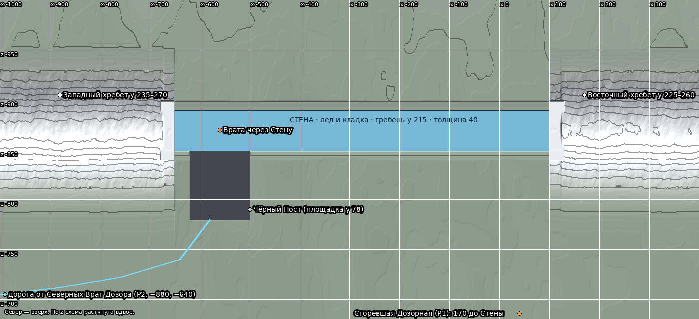

# Стена · карта высот (Р3)

Oct 20, 2026 · Архитектор → Штаб, Claude Code

Вторая ключевая форма рельефа, тот же формат, что у Кольцевой горы. Claude Code строит по ней Стену, хребет и площадку Чёрного Поста; остальное вокруг — генерация.

## Файлы

| Файл | Что это |
| --- | --- |
| `the_wall_height.png` | Карта высот: 1400×320, 8 бит, **1 пиксель = 1 блок**, **y = значение + 40**. Левый верхний пиксель — (x −1000, z −1000) |
| `the_wall_material.png` | Маска того же размера: 0 — рельеф, 100 — тело Стены (строится из льда и кладки, см. карточку Стены), 200 — площадка Чёрного Поста |
| `the_wall_preview.png` | Схема для глаз: цвет по высоте, горизонтали через 20, подписи. **По z растянута вдвое**, чтобы читалась толщина Стены |
| `the_wall_profiles.csv` | Профили с юга на север (z −690 → −1000, шаг 10) на 9 долготах |
| `src/the_wall.py` | Генератор, детерминирован |

## Форма

- **Стена.** x −650…+100 (750 блоков), южная грань z −850, толщина 40 (до z −889). Гребень y 215, по краям парапеты y 218. Земля у подножия y 76–78, видимая высота около 140. Вдоль обеих граней — осыпь ледяных глыб шириной 10, до +8.
- **Хребет.** Стена закрывает единственный проход в сплошном хребте, который идёт с запада на восток **через весь мир**. На этой карте видны его куски: западный (x −1000…−650) до y 235–270 и восточный (x +100…+400) до y 225–260. Ось хребта z −870, южное подножие не дальше z −790. За пределами карты хребет продолжается по той же оси до краёв играбельной зоны (x −1500 и +1500), высота 230–270.
- **Стык.** 30 блоков от концов Стены хребет не ниже гребня Стены: обойти её по краю нельзя.
- **Чёрный Пост.** Ровная площадка 120×70 на y 78 у южного подножия, x −620…−500, z −849…−780.
- **Дорога с Р2.** От Северных Врат Дозора (−880, −640) на северо-восток к Посту — у подножия хребта, на карте голубая линия.

## Для Claude Code

- Хребет должен быть **непроходимым**, иначе Стена ничего не запирает. Склоны генератор делает крутыми, но игрок может строить ступени. Нужен невидимый барьер по гребню хребта: стена из `barrier` от поверхности до y 320 по оси z −870 на всю ширину мира, кроме участка Стены (x −650…+100). Это решение для рамок — вопрос Штабу в карточке Стены.
- Стену строить по маске материала, как описано в карточке: высота — из PNG, слои и материал — из карточки.
- Проверка: профили `the_wall_profiles.csv`, допуск ±3 на хребте, 0 на Стене.
- Сгоревшая Дозорная (Р1, (+40, −680), площадка y 124) — в 170 блоках от южной грани Стены, напротив её восточной части: Стена должна быть видна оттуда во весь рост при прорисовке 12 чанков.
