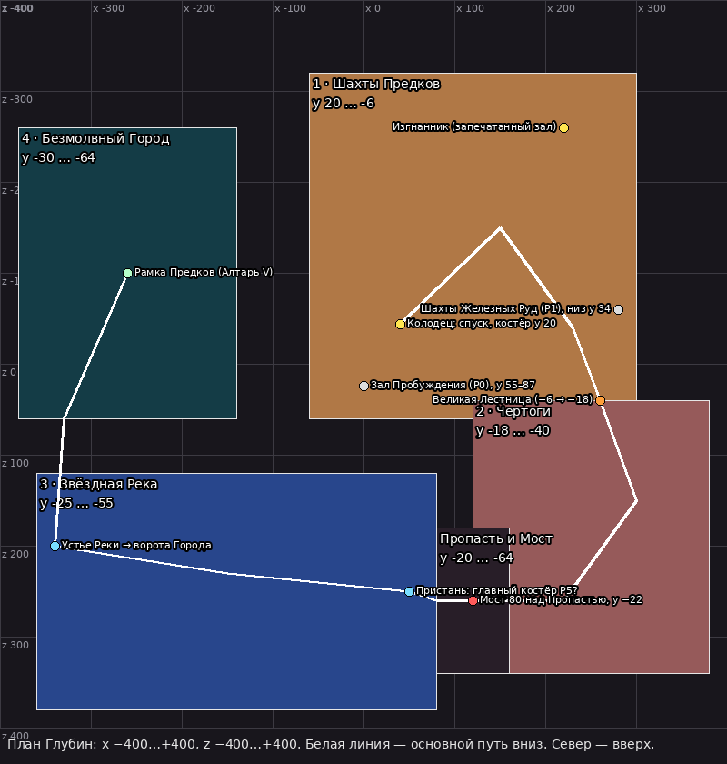
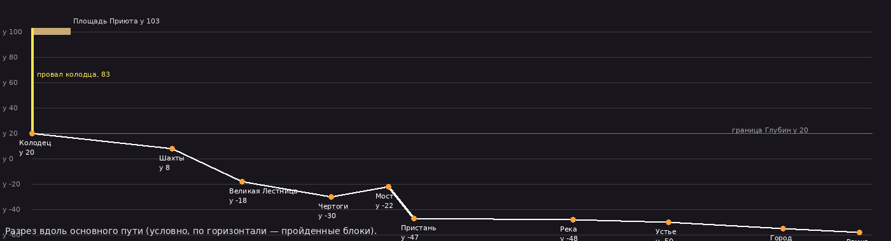

# The Last Ember · Карточки локаций Р5, партия 1

Oct 21, 2026 · Архитектор → Штаб

Р5 — Глубины, в три партии.

1. **Эта партия:** раскладка по уровням, спуск из Запечатанного колодца, Шахты Предков (уровень 1), Изгнанник в запечатанном зале.
2. **Партия 2:** Чертоги и Мост (уровень 2), Звёздная Река (уровень 3).
3. **Партия 3:** Безмолвный Город (уровень 4), Рамка Предков (Алтарь V), сокровищницы, мечи, костры, шорткат.

Версия 2 (21.10): всё принято Штабом, координаты утверждены, ответы внесены. С этой партии во всех неразрушимых зонах — правило фундамента: зона включает основание постройки на 3–5 блоков ниже (у висящих — днище целиком).

## Раскладка Глубин

**Объём.** x −400…+400, z −400…+400, y −64…20 (рамки). Уровни идут не только вниз, но и вбок: каждый следующий — глубже и дальше от колодца, путь — спираль вокруг хаба против часовой стрелки.

| Уровень | Объём | y | Что |
| --- | --- | --- | --- |
| Спуск | провал колодца над (+40, −44) | 103 → 20 | Из хаба вниз, костёр на дне |
| 1 · Шахты Предков | x −60…+300, z −320…+60 | 20 … −6 | Рудник гномов, рельсы, кузни |
| Великая Лестница | (+260, +40) | −6 → −18 | Переход 1 → 2 |
| 2 · Чертоги | x +120…+380, z +40…+340 | −18 … −40 | Залы с колоннами |
| Пропасть и Мост | x +80…+160, z +180…+340 | −20 … −64 | Мост 80 на y −22, с востока на запад |
| 3 · Звёздная Река | x −360…+80, z +120…+380 | −25 … −55 | Полость, река на y −48, путь на лодке на запад |
| 4 · Безмолвный Город | x −380…−140, z −260…+60 | −30 … −64 | Древний город, глубокая тьма |
| Рамка Предков | (−260, −100) | около −55 | Алтарь V, портал в Незер |

**Проверки соседства** (по рамкам: подземное Р1 — не ниже y 30, между ним и Глубинами не меньше 10 блоков сплошной породы).

| Над Глубинами | Низ, y | Под ним | Верх, y | Порода |
| --- | --- | --- | --- | --- |
| Площадь Приюта | 103 | Шахты Предков | 20 | 83 |
| Зал Пробуждения (Р0) | 55 | Шахты Предков | 20 | 35 |
| Шахты Железных Руд (Р1), (+280, −60) | 34 | Шахты Предков | 20 | 14 |
| Склепы кладбища (Р1) | 35 | вне объёма Глубин (z +372…+524) | — | — |
| Шахты Предков | −6 | Чертоги (угол x +120…+300, z +40…+60) | −18 | 12 |

Уровни 3 и 4 не лежат друг под другом: Река на юге, Город на северо-западе.

## 1. Спуск из Запечатанного колодца · Р5

Шаблон «после» колодца — в карточке Р0, партия 2. Здесь — то, что ниже y 20 и как спуск встречает Глубины.

**Положение.** Провал 9×9 над (+40, −44), от двора колодца (y 102 после сдвига высот Р0) до нижней площадки y 20 — около 83 блоков винтовым спуском по стенам (Р0).

**Нижняя площадка.** На y 20 провал открывается в первый зал Шахт Предков — **Зал Ворот**: 24×20, высота 12. Спуск выходит на балкон над залом, вниз — каменная лестница гномов.

- **Костёр Глубин № 1** — на балконе (Р0: «первый костёр Глубин на нижней площадке спуска»), y 20. Это костёр «вход в регион».
- **Ворота Предков** — в северной стене зала: каменные двери 7×9 с рельефом молота и кирки (знак Р5 с ворот шортката на площади). Двери приоткрыты — между створками щель, через которую пролезает человек. Створки сдвинуты землетрясением главы 4.
- **Знак.** На пороге — плита с рунами гномов. Записка: «Мы копали слишком глубоко».

**Образ.** Спуск из хаба — последние метры света. Внизу пахнет железом и холодом. Балкон над залом, костёр, и ворота, за которыми слышно, как кто-то бьёт киркой. Это стук из колодца, который игроки слышали всю игру.

**Палитра.** Зал Ворот — `deepslate_bricks`, `polished_deepslate`, `chiseled_deepslate`; ворота — `polished_blackstone_bricks` с рельефом из `chiseled_polished_blackstone`; балкон — `deepslate_tile_slab` на `deepslate_brick_wall`.

**Свет.** Костёр на балконе, по фонарю у ворот. Зал — полутьма.

**Пути.** Провал ↔ балкон ↔ зал ↔ ворота в Шахты. Зона приключения: провал целиком (уже, Р0) и Зал Ворот с фундаментом (y 5…35).

**Технические заметки.** Зал Ворот — 1 кусок `.nbt` 24×20×16. Ворота — swap «закрыты / приоткрыты», срабатывает вместе с провалом колодца при землетрясении главы 4.

## 2. Шахты Предков · Р5, уровень 1

**Роль.** Главный рудник карты: железо, золото, редстоун, немного лазурита, алмазы в самых глубоких штольнях. Рельсовые пути, вагонетки.

**Положение.** x −60…+300, z −320…+60, y 20…−6. От Зала Ворот штольни расходятся на север и восток. Выход вниз — Великая Лестница у (+260, +40).

**Габариты.** 360×380 по горизонтали, 3 горизонта: y 16, y 6, y −4. Высота штолен 4–6, залы — до 14.

**Образ.** Гномье царство, разбуженное слишком глубоким копанием. Ровные, как по линейке, штольни с каменной облицовкой; рельсы, стрелки, подъёмники в шахтах между горизонтами; кузни, где ещё тлеют горны. Здесь работали тысячи — и в один день все бросили инструменты. Мёртвые гномы до сих пор ходят по своим маршрутам.

**Структура по частям.**

1. **Главная штольня.** От Зала Ворот на восток, 250 блоков, ширина 7, двухпутная рельсовая линия, каждые 40 — ниша со статуей гнома-предка.
2. **Горизонты.** Три горизонта (y 16, 6, −4). Вниз впервые — по лестницам и наклонным штрекам. Рядом с каждым спуском — клетевая шахта 5×5: клеть (перенос датапаком, как у Чёрного Поста) начинает работать на горизонте, когда команда до него дошла. Это внутренний шорткат.
3. **Рудные штреки.** По каждому горизонту — 6–10 штреков с жилами. Глубже — ценнее.
4. **Кузни Предков.** Два больших зала 30×24, высота 14: горны с лавой за решётками, наковальни, столы кузнеца, кузнечные меха (декор). Одна — разрушена. Вторая — **целая Кузня**, у (+150, −120), y 16: рабочее место для улучшения снаряжения (стол кузнеца, наковальня, горн) и **главный костёр Р5** с Урной Р5 (вариант `deepslate` со `sculk`) и дверью шортката Р5 — к ней ведут ворота Р5 с площади Приюта. Дверь врезана в восточную стену Кузни, портал из `deepslate_tiles` с `chain`, знак — молот и кирка.
5. **Казармы и трапезные.** Залы-ряды с каменными лежанками и длинными столами.
6. **Обвалы.** 4–5 мест: часть штреков перекрыта, обход есть. Честные обвалы как в Шахтах Р1 (2 секунды предупреждения).
7. **Запечатанный зал Изгнанника** — карточка 3.

**Руда.** Объём по Штабу (черновик, главный запас карты): уголь ~60, медь ~40, железо ~120, золото ~60, редстоун ~80, лазурит ~20, алмазы ~12. Распределение по горизонтам:

| Горизонт | y | Руда |
| --- | --- | --- |
| Верхний | 16 | `deepslate_coal_ore` ~60, `deepslate_copper_ore` ~40, `deepslate_iron_ore` ~60 |
| Средний | 6 | `deepslate_iron_ore` ~60, `deepslate_gold_ore` ~30, `deepslate_redstone_ore` ~40, `deepslate_lapis_ore` ~20 |
| Нижний | −4 | `deepslate_gold_ore` ~30, `deepslate_redstone_ore` ~40, `deepslate_diamond_ore` ~12 — только в двух самых дальних штреках |

Руда — полосами в стенах штреков, как в Р1, только в отмеченных штреках.

**Палитра.**

| Часть | Блоки и доли |
| --- | --- |
| Облицовка штолен | `deepslate_bricks` 35%, `polished_deepslate` 20%, `cobbled_deepslate` 20%, `deepslate_tiles` 15%, `cracked_deepslate_bricks` 10% |
| Порода | `deepslate`, `tuff`, `cobbled_deepslate` |
| Крепь | `dark_oak_log`, `polished_blackstone_wall` (гномы крепили камнем) |
| Рельсы | `rail`, `powered_rail` (без питания — декор), стрелки |
| Кузни | горны `blackstone` с лавой за `iron_bars`, `anvil`, `smithing_table`, `blast_furnace`, медь разных стадий в трубах и котлах (`waxed_*`) |
| Статуи предков | `polished_deepslate`, бороды — `waxed_weathered_copper` |
| Свет | `lantern`, медные лампы (`copper_bulb`, часть выключена) |

**Свой биом.** Нет: ванильные глубинные пещеры. Предлагаю верхнему уровню — без своего биома, контраст с «Чертогами» ниже.

**Свет.** Главная штольня — медные лампы через 12 (половина не горит). Штреки — тьма, спавн мёртвых гномов, скелетов, пещерных пауков, чешуйниц в заражённых стенах. Кузни — свет лавы.

**Точки для механик.**

- Костры: Зал Ворот (вход в регион) и целая Кузня Предков — главный костёр Р5, Урна, дверь шортката.
- Клетевые шахты: по 2 точки на клеть (верх и низ), включение по первому приходу на горизонт.
- Мёртвые гномы: маршруты по главной штольне (точки начала и конца).
- Целая Кузня: стол кузнеца, наковальня, горн — улучшение снаряжения.
- Обвалы: 4–5 точек swap.
- Сундуки: 3 (казармы, кладовая кузни, контора рудника).
- Компас восстановления (рамки «учит»): осколки эха — в Безмолвном Городе (партия 3); здесь, в конторе рудника, — стол с недоделанным компасом и запиской гнома-навигатора.

**Пути.** Зал Ворот → главная штольня → кузни → горизонты → Великая Лестница вниз. Шахта разрушаема (рамки); кузни и Зал Ворот — зоны приключения (интерьеры, с фундаментом).

**«Угасшая» версия.** Нет.

**Нагрузка.** Блочные сущности: 3 сундука, 8–10 бочек, наковальни, печи. Сущности: 4–6 вагонеток. Мобы: до 20 на уровне. Редстоун: нет.

**Идеи для игры.** Приняты Штабом: мёртвые гномы нейтральны, пока им не мешают (идут по маршруту, бьют в стену; нападают, если встать на пути или взять руду из «их» штрека) — подземелье, которое можно пройти тихо; скалк за стеной у алмазов; недоделанный компас восстановления с запиской навигатора.

**Технические заметки для Claude Code.**

- Уровень — скрипт: штольни по сетке, облицовка, рельсы. `.nbt`: Зал Ворот, 2 кузни, казармы, статуя предка (1 шаблон).
- Руда — только полосами в отмеченных штреках, объём — Штаб.

**Референсы.**

| Арт | Что взято |
| --- | --- |
| Майнкрафт-дома в пещере под деревом | обжитые пещерные залы |
| Майнкрафт-карьер с копром | крепь и рельсы |
| Красные акведуки | ритм арок в главной штольне |

**Решено Штабом.** Объём руды — в таблице. Клети — внутренний шорткат после первого прихода. Мёртвые гномы нейтральны.

## 3. Изгнанник в запечатанном зале · Р5, скрытый торговец

**Роль.** Скрытый торговец — Гном-изгнанник.

- **Положение.** (+220, −260), y 6 — в средний горизонт, в конце заброшенного штрека на северо-востоке Шахт.
- **Вход.** Штрек кончается глухой стеной, на ней — рунная печать (`chiseled_deepslate` в рамке из `polished_blackstone`). Печать снимается, если постучать в правильном ритме — три удара, пауза, один — нажатия на кнопку-камень в стене (`polished_blackstone_button`). Подсказка — записка на трупе гнома у входа в штрек.
- **Зал.** 14×12, высота 6: каменная лавка, горн, стеллажи с товаром. Сухо, тепло, светло.
- **Изгнанник.** Последний живой гном. Его изгнали за то, что он говорил «не копайте глубже». Его не послушали — все мертвы. Он запечатался и ждёт. Торгует инструментами, рудой, улучшениями (решает экономика).
- **Палитра.** `polished_deepslate`, `deepslate_tiles`, `blackstone`, `lantern`, `barrel`, `smithing_table`.
- **Пути.** Штрек ↔ зал. Зона приключения: зал с фундаментом.
- **Решено Штабом.** Ритм «три удара, пауза, один» — ключ от печати.
