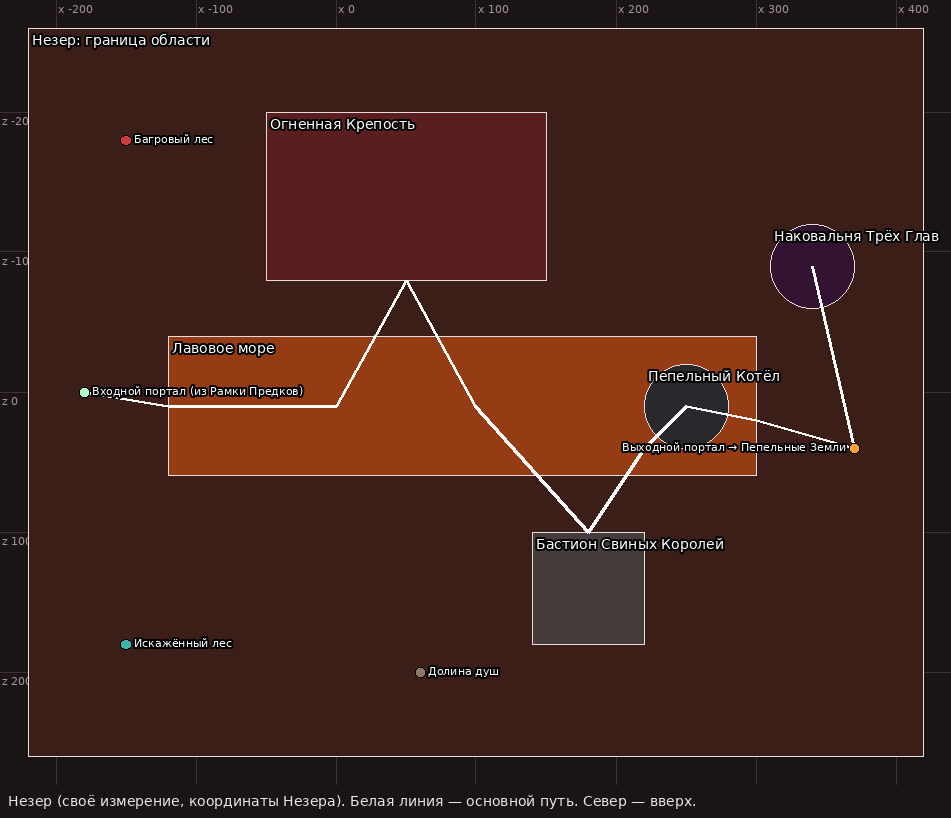
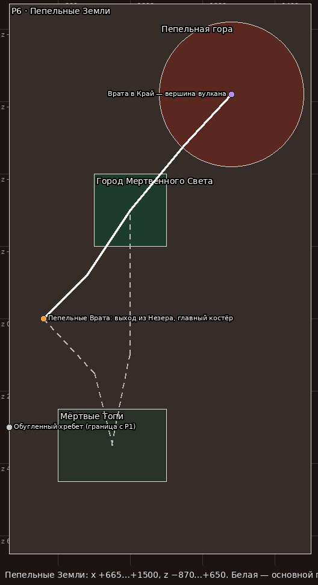

# The Last Ember · Карточки локаций Р6, партия 1

Oct 21, 2026 · Архитектор → Штаб

Р6 — Испод (Незер) и Пепельные Земли (восток верхнего мира, x > +665). Делю на четыре партии.

Версия 2 (21.10): всё принято Штабом, координаты утверждены, ответы внесены. Основной путь по поверхности — прямо от Врат к Городу, Топи — необязательная петля. Банды в Р6 нет.

1. **Эта партия:** раскладка Незера и поверхности, каркас Незера (границы, порталы, мосты), арена Пепельного Духа «Пепельный Котёл», Пепельные Врата (выход на поверхность, главный костёр Р6).
2. **Партия 2:** Огненная Крепость, Бастион Свиных Королей, Наковальня Трёх Глав (Алтарь VI).
3. **Партия 3:** Пепельная Пустошь, Мёртвые Топи, Город Мертвенного Света.
4. **Партия 4:** Пепельная гора (карта высот вулкана, Скит Пепельного Монаха, врата в Край), сокровищницы, мечи, костры (банды в Р6 нет).

## Раскладка Незера

Незер не связан с верхним миром правилом 1:8 (рамки), поэтому его координаты свободны. Ниже — координаты Незера. Если рельеф боевого сида в этом месте не подойдёт, всю раскладку можно сдвинуть целиком, ничего больше не меняя (см. вопрос 1).

| Часть | Где (x, z) | y | Что |
| --- | --- | --- | --- |
| Граница области | −220…+420, −260…+260 | 0…127 | 640×520, дальше — стена и барьер |
| Входной портал | (−180, 0) | ~70 | Сюда переносит Рамка Предков. Костёр «вход в Незер» |
| Лавовое море | −120…+300, −40…+60 | лава y 31 | Ванильный уровень лавы. Мосты и острова |
| Огненная Крепость | −50…+150, −200…−80 | 50…100 | Партия 2. Иссушённые скелеты, огненные духи |
| Бастион Свиных Королей | +140…+220, +100…+180 | 35…80 | Партия 2. Бартер, ключевой предмет |
| Пепельный Котёл | круг (+250, +10), r 30 | остров y 34…40 | Арена Пепельного Духа, карточка 2 |
| Выходной портал | (+370, +40) | ~45 | Два направления: Пепельные Врата ↔ Незер |
| Наковальня Трёх Глав | круг (+340, −90), r 30 | ~60 | Партия 2. Алтарь VI, призыв иссушителя |
| Багровый лес | около (−150, −180) | — | Северо-запад, вдоль пути к Крепости |
| Искажённый лес | около (−150, +180) | — | Юго-запад, в стороне, тайник |
| Долина душ | около (+60, +200) | — | Юг, подход к Бастиону с тыла |

**Основной путь** (белая линия на плане): входной портал → мост через западный край моря → остров (0, 0) → ворота Крепости (+50, −80) → обратно к морю (+100, 0) → Бастион (+180, +100) → мост на Котёл (+220, +10) → бой → восточный мост → выходной портал (+370, +40). Наковальня — в стороне от портала, к ней ведёт тропа на север, закрытая до сбора трёх глав.

**Почему Наковальня у выходного портала.** Если две главы из трёх добываются на поверхности (см. вопрос 3), команде придётся вернуться в Незер. От Пепельных Врат через портал до Наковальни — около 140 блоков, без повторного прохода всего Незера.

## Раскладка Пепельных Земель

Поверхность: x +665…+1500, z −870…+650. С запада — Восточный хребет (ось x +665), с севера — Северный хребет со Стеной (z −870), с юга — Ржавый Разлом (z +650), с востока — край мира. Ворот нет: в Р6 попадают только через Незер (Границы регионов).

| Часть | Где (x, z) | Что |
| --- | --- | --- |
| Пепельные Врата | (+760, 0) | Выход из Незера, главный костёр Р6, Урна, дверь шортката. Карточка 3 |
| Мёртвые Топи | +800…+1100, +250…+450 | Партия 3. Гати над чёрной водой |
| Город Мертвенного Света | +900…+1100, −400…−200 | Партия 3. Последняя крепость врага, ключевой предмет |
| Пепельная гора | круг (+1280, −620), r 200 | Партия 4. Вулкан в северо-восточном углу, на вершине врата в Край |
| Пепельная Пустошь | всё остальное | Партия 3. Свой биом, пепел вместо снега |

**Основной путь** (решено Штабом): Врата → прямо на северо-восток к Городу (около 360) → склоны горы → вершина. Порядок главы: Крепость → Бастион → Котёл → поверхность → Город → порталом назад к Наковальне → иссушитель → звезда Незера → вершина.

**Мёртвые Топи** — необязательная петля к югу от Врат (пунктир на плане): торговец, сокровищница, лор.

**Проверка соседства.** Вулкан r 200 у (+1280, −620): его северный край z −820 в 50 от оси Стены (z −870). Подножие на севере надо срезать по хребту (вулкан «прижат» к Стене) — уточню картой высот в партии 4. Восточный край x +1480 — в 20 от края мира, по краю — барьер (как везде).

---

## 1. Каркас Незера · Р6

**Роль.** Ограниченная построенная область Незера: одна большая пещера над лавовым морем, по которой проложен путь от портала Рамки Предков до выходного портала в Пепельные Земли.

**Положение.** Координаты Незера x −220…+420, z −260…+260, y 0…127 (крыша из бедрока — ванильная, y 127).

**Габариты.** 640×520, рабочая высота y 31 (лава) … ~110 (свод).

**Образ.** После тишины Безмолвного Города — жар и рёв. Портал выводит на уступ высоко над морем лавы: под ногами бездна огня, на севере в дыму — силуэт Крепости, по своду ползут отсветы. Здесь упавшее солнце прожгло мир насквозь, и Испод — это то, что под ожогом.

**Структура по частям.**

1. **Рельеф.** Ванильная генерация Незера боевого сида (лавовое море на y 31, своды, столбы) + правка скриптом: расчистить главный объём над морем, где он слишком тесный, и убрать ванильные «ходы» за границу.
2. **Биомы** (ставятся `fillbiome`, ванильные): северо-запад — `crimson_forest`, юго-запад — `warped_forest`, юг — `soul_sand_valley`, восток (Котёл, Наковальня, выходной портал) — `basalt_deltas` (ванильный пепел в воздухе и серый туман — готовое настроение «пепельного» края), центр и море — `nether_wastes`.
3. **Граница области.** По периметру — стена из `netherrack`/`basalt` (где рельеф и так сплошной — ничего не строить) и `barrier` по линии границы от y 0 до 127. Над крышей бедрока — `barrier` слоем на y 128, чтобы не выйти на крышу Незера.
4. **Входной портал** (−180, 0), y ~70: уступ 16×12 на скальной стене над западным берегом моря. Портал — рамка из `obsidian` 4×5 в обкладке `crying_obsidian` (рифма с Рамкой Предков). Рядом — **костёр входа в Незер** (вход в регион). С уступа вниз — тропа-серпантин к мосту.
5. **Мосты.** Каменные мосты гномов-изгнанников, которые когда-то ходили в Испод за обсидианом: ширина 3, без перил, из `polished_blackstone_bricks` на быках `basalt`. Три моста:
   - **Западный** — от берега (−120, 0) к острову (0, 0), 120 блоков, два острова-быка по пути.
   - **Восточный** — от Бастиона к Котлу (+220, +10), и от Котла к выходному порталу (+280 → +370), 90 блоков.
   - **Северный** — с острова (0, 0) к воротам Крепости, частично подвесной (цепи к своду).
6. **Острова.** 3–4 островка `basalt`/`blackstone` в лаве — площадки для костров, отдыха и засад огненных духов.
7. **Выходной портал** (+370, +40), y ~45: на базальтовом плато восточного берега. Рамка из `obsidian` 4×5 в арке из `polished_basalt`. Работает в обе стороны.

**Палитра.**

| Часть | Блоки и доли |
| --- | --- |
| Мосты | `polished_blackstone_bricks` 50%, `cracked_polished_blackstone_bricks` 25%, `blackstone` 15%, `gilded_blackstone` 0–2% (только внутри зон), быки — `basalt`, `polished_basalt` |
| Порталы | `obsidian`, обкладка `crying_obsidian`, арка `polished_basalt` |
| Стены границы | `netherrack` 50%, `basalt` 30%, `blackstone` 20% |
| Острова | `basalt`, `blackstone`, `magma_block` вкрапления 10% |

**Свой биом.** Нет, только ванильные биомы Незера, расставленные `fillbiome`.

**Свет.** Лава, огонь на `netherrack`, грибной свет (`shroomlight`) в лесах. На мостах — `soul_lantern` на цепях через 20 блоков (свет гномов-изгнанников, синий против красного моря).

**Точки для механик.**

- Входной портал — точка прибытия из Рамки Предков (переносит скрипт).
- Выходной портал — объём переноса в Пепельные Врата и точка прибытия оттуда.
- Костры: вход (−180, 0); у ворот Крепости (+50, −80) — около 270 по пути от входа; перед Котлом (+205, +10); у выходного портала (+370, +40). Итог — в схеме костров партии 4.
- Падение в лаву — смерть, пепельный след уходит в Урну (как пропасть — правило следа).

**Пути.** Основной путь — выше. Зона приключения: уступ входного портала (r 12), мосты (полоса 7 по оси), острова с кострами, плато выходного портала, Котёл, Крепость, Бастион, Наковальня (их границы — в партии 2). Остальной Незер разрушаем: копать `netherrack` можно, это тоже «учит».

**«Угасшая» версия.** Нет.

**Нагрузка.** Мобы: ванильный спавн Незера по биомам, но не больше 30 на всю область (гасты — не больше 3 одновременно: в закрытой пещере их огонь по мостам быстро надоедает). Сущности: нет. Блочные: 2 портала, 4 костра.

**Идеи для игры (предложения).**

- Гномы-изгнанники ходили сюда за обсидианом: на островах — их брошенные лагеря и записки, по которым видно, что Изгнанник (Р5) знал дорогу.
- Огнестойкость «учится» сама: первый мост проходит под капелью лавы со свода (частицы `dripping_lava` и редкие огненные блоки на мосту), а у Бастиона продают зелья.
- Тайник в Искажённом лесу (юго-запад, в стороне) — первый запас огнестойкости для тех, кто исследует.

**Технические заметки для Claude Code.**

- **Порталы игроков.** Игрок может сам собрать портал в верхнем мире (обсидиан из лавы и воды, огниво). По рамкам порталы не связаны 1:8: любой вход в Незер не через наш портал нужно перехватить (вернуть игрока на место и, например, погасить портал) — иначе он попадёт в ванильный Незер вне области. То же для порталов, собранных в Незере. Предлагаю в `tick` раз в 10 тиков проверять смену измерения у игроков без тега «прошёл наш портал».
- Наши порталы держатся блоками `nether_portal` в обсидиановой рамке, перенос — скриптом при входе в объём (как у Рамки Предков).
- Структуры Незера в ванильной генерации уже выключены (T-001) — Крепость и Бастион строим сами.
- Перед боевым миром отрендерить Незер сида 10845 в этой области (y-срезы 40 и 70), чтобы проверить, где лавовое море. Если не там — сдвинуть раскладку целиком.

**Референсы.** Рамки (Р6: Харренхолл для Крепости, ванильные биомы Незера).

**Решено Штабом.** Рельеф — ванильный сид + `fillbiome` + правка скриптом (рендер срезов — билдеру). Самодельные порталы перехватываем. Лагеря изгнанников, капель лавы, тайник с огнестойкостью — приняты.

---

## 2. Пепельный Котёл · Р6, арена Пепельного Духа

**Роль.** Арена боя с Пепельным Духом. Он преследовал команду на мосту в Глубинах (Р5), здесь его можно победить. Бой открывает восточный мост к выходному порталу.

**Положение.** Незер, остров в лаве, центр (+250, +10), радиус 30. Поверхность острова y 36–40, лава y 31.

**Габариты.** Остров 60 в диаметре, над ним свободный объём до y ~90 (Дух летает).

**Образ.** Чёрный базальтовый остров посреди моря лавы, похожий на перевёрнутую чашу: края приподняты зубцами, в центре — впадина с магмой, будто котёл, в котором варят огонь. Вокруг — пепел `basalt_deltas`, над островом свод с потёками. Мост с запада упирается в остров, мост на восток лежит под лавой, видны только верхушки быков.

**Структура по частям.**

1. **Остров.** Круг r 30. Края — кольцо зубцов `basalt` высотой 3–6 (укрытия от шаров). Поверхность — `blackstone` и `basalt`, к центру понижается на 3.
2. **Котёл** — впадина r 8 в центре, дно из `magma_block` (жжёт, если стоять). Отсюда Дух поднимается в начале боя.
3. **Восемь столпов** `polished_basalt` по кругу r 18, высота 8–12 — укрытие и опоры для второй фазы.
4. **Западный мост** (вход) — заканчивается площадкой с **костром перед ареной** (+205, +10), в 15 от края острова.
5. **Восточный мост** — под лавой, поднимается (swap) после победы. Ведёт к выходному порталу.
6. **Кольцо обрушения** — внешние 6 блоков острова (r 24…30) разбиты на 4 сектора-четверти для второй фазы.

**Бой — предложение схемы, решение за Штабом.**

- **Фаза 1.** Дух поднимается из Котла и парит над островом на высоте 10–15. Бросает синие шары (слабость и замедление, как на мосту), между бросками — опускается к одному из столпов и бьёт по площади. Бить его можно, когда он у столпа.
- **Фаза 2 (половина здоровья).** Дух ныряет в лаву. Один из четырёх секторов кольца обрушения проседает в лаву (swap на `magma_block`, через 3 секунды — на лаву, с предупреждением частицами и звуком). Он выныривает у другого края. Так арена сужается: остаются центр и столпы.
- **Фаза 3 (четверть здоровья).** Котёл в центре вспыхивает: магма становится огнём души (`soul_fire` на `soul_soil` — синий огонь, отсылка к шарам). Дух больше не ныряет, бьётся у центра.
- **Конец.** Дух осыпается пеплом в Котёл. Из лавы поднимается восточный мост, Котёл гаснет.
- **Поражение всех.** Арена возвращается в исходное: секторы поднимаются, восточный мост остаётся под лавой. Костёр перед ареной.

**Палитра.**

| Часть | Блоки и доли |
| --- | --- |
| Остров | `basalt` 40%, `blackstone` 30%, `smooth_basalt` 15%, `polished_basalt` 10%, `magma_block` 5% |
| Котёл | `magma_block`, по краю `polished_blackstone` |
| Столпы | `polished_basalt` с поясами `chiseled_polished_blackstone` |
| Мосты | как в каркасе |

**Свой биом.** Нет: ванильный `basalt_deltas` (пепел в воздухе, серо-бурый туман).

**Свет.** Только лава и магма. В фазе 3 — синий огонь души в центре.

**Точки для механик.**

- Триггер-зона: остров целиком, вход — когда все живые игроки на острове или на последних 10 блоках моста.
- Точка подъёма Духа — центр Котла (+250, +10, y 33).
- 8 точек столпов (Дух опускается к ним в фазе 1).
- 4 сектора кольца обрушения — swap с откатом.
- Swap Котла (магма → огонь души).
- Swap восточного моста (под лавой → поднят).
- Костёр перед ареной (+205, +10).

**Пути.** Западный мост → остров → (после боя) восточный мост → выходной портал. Зона приключения — остров с фундаментом до дна лавы, оба моста, площадка костра.

**«Угасшая» версия.** Котёл после боя: лава вокруг тише, Котёл холодный, мост поднят.

**Нагрузка.** Сущности: Дух (1 моб + 1–2 display-сущности для модели), шары — 2–4 снаряда одновременно. Без помощников-мобов: в Незере и так шумно. Блочные: нет.

**Идеи для игры (предложения).**

- Дух — то, что осталось от огня: если игрок пил огнестойкость, лава и магма ему не страшны, но шары слабости — да. Огнестойкость здесь полезна, но не решает бой.
- Перед ареной, на последнем быке западного моста, — следы гнома-изгнанника, который «видел, как огонь стал синим».
- Награда: кроме прохода — **Пепел Духа**, по одному каждому игроку (принято; применение Штаб решит вместе с экономикой).

**Технические заметки для Claude Code.**

- Остров 60×60 не влезает в 48 — 4 куска `.nbt` по четвертям 30×30×16. Секторы обрушения и восточный мост — swap с откатом.
- Модель Духа — на усмотрение билдера (ресурс-пак, модель предмета на display-сущности поверх невидимого моба). Ванильных мобов глобально не перекрашиваем.
- Синие шары — как на мосту в Р5 (тот же снаряд и эффекты).
- Падение с острова в лаву — смерть и след, как везде.

**Референсы.** Ответ Штаба на Р5 п2 (Пепельный Дух: чёрный ифрит-нежить, синие шары слабости и замедления).

---

## 3. Пепельные Врата · Р6

**Роль.** Выход из Незера в Пепельные Земли. Главный костёр Р6, Урна Р6, дверь шортката в Приют. Первая точка верхнего мира Р6.

**Положение.** Верхний мир, (+760, 0), в 95 к востоку от оси Восточного хребта. Высота — по рельефу Пустоши (уточню в партии 3).

**Габариты.** 32×24, высота башен 24, фундамент на 5 ниже.

**Образ.** Ворота без стены. Две полуразрушенные башни из чернокамня стоят посреди серой равнины, между ними — арка, а в арке — портал, из которого игроки выходят. Кругом пепел, небо красно-бурое, пепел падает, как снег. Кто-то когда-то поставил здесь ворота, чтобы не пускать из Испода, — или чтобы встречать.

**Структура по частям.**

1. **Две башни** 9×9, высота 24 и 18 (южная обломана). Внутри — лестница наверх, на южной — обзорная площадка на обломе.
2. **Арка** между башнями, ширина 10, высота 14. В арке — портал 4×5 в обсидиановой рамке (точка прибытия из Незера и вход обратно).
3. **Двор** 16×12 перед аркой на восток. Здесь — **главный костёр Р6** и **Урна Р6** (вариант `blackstone` + `basalt`).
4. **Дверь шортката** — в северной башне, со двора: портал из `polished_basalt` с `chain`, знак над дверью — пламя внутри горы (знак Р6 на воротах шортката Приюта).
5. **Фреска** на внутренней стене южной башни: Пепельная гора с дымом, Город у её подножия, Топи. Это карта Р6 на стене — вулкан от Врат не виден (см. вопрос 2).
6. **Фундамент** — 5 блоков вниз, чернокамень.

**Палитра.**

| Часть | Блоки и доли |
| --- | --- |
| Башни | `polished_blackstone_bricks` 40%, `cracked_polished_blackstone_bricks` 25%, `blackstone` 20%, `basalt` 10%, `gilded_blackstone` 5% (внутри зоны) |
| Арка | `polished_basalt`, замковый камень `chiseled_polished_blackstone` |
| Портал | `obsidian`, обкладка `crying_obsidian` |
| Двор | `polished_blackstone`, пепел по краям — `gray_concrete_powder`, `light_gray_concrete_powder`, `tuff` |
| Фреска | `blackstone` фон, гора — `basalt` и `magma_block`, Город — `dark_prismarine`, Топи — `mud` |

**Свой биом.** «Пепельная Пустошь» (рамки): красно-бурое небо, плотный серый туман, пепел. Реестр биомов ведёт отдельная сессия, здесь только ссылка.

**Свет.** Костёр, свет портала, `soul_lantern` у двери шортката.

**Точки для механик.**

- Портал — объём переноса в Незер (+370, +40) и точка прибытия оттуда.
- Главный костёр Р6, Урна, дверь шортката.
- Обзорная площадка на южной башне (y ~20 над землёй) — вид на Пустошь и Топи.

**Пути.** Врата → Пустошь на юг (Топи) или на северо-восток (Город). Назад — порталом в Незер (к Наковальне) или дверью шортката в Приют. Зона приключения — двор, башни, арка, фундамент 5 вниз.

**«Угасшая» версия.** До первого прихода костёр холодный, Урна пустая (как у других главных костров).

**Нагрузка.** Блочные: портал, костёр, Урна. Сущности: нет. Мобы: спавн Пустоши вокруг, во дворе — нет (зона костра).

**Идеи для игры (предложения).**

- Обзорная площадка — первое место, откуда видно дым над горизонтом (если Штаб примет дым-ориентир, вопрос 2).
- Записка у костра: «Ворота ставили, чтобы закрыть Испод. Потом поняли, что закрывать надо было с другой стороны».

**Технические заметки для Claude Code.** 1 кусок `.nbt` 32×24×30 (≤ 48 по каждой оси). Портал — как в каркасе Незера.

**Референсы.** Рамки (Р6: Мордор, Чёрные Врата как образ ворот без стены).

---

## Решено Штабом

1. **Рельеф Незера** — ванильная генерация сида 10845, `fillbiome`, правка скриптом. Если лавовое море не ложится на раскладку — раскладка сдвигается целиком.
2. **Вулкан** не двигаем. Ориентиры: фреска во Вратах, гул вулкана со стороны горы, пепел и красно-бурое небо по всему региону.
3. **Три главы — три уникальных черепа с именами:** Глава Пепла (Огненная Крепость, элитный иссушённый скелет), Глава Золота (Бастион, трофей Свиного Короля), Глава Света (Город Мертвенного Света). На Наковальне — песок душ буквой Т; когда все три на месте, датапак проводит призыв иссушителя. Победа даёт звезду Незера для врат в Край. Обычные черепа иссушённых скелетов из мира не выпадают.
4. **Самодельные порталы** перехватываем.
5. **Пепельный Котёл** — схема боя принята целиком; награда — Пепел Духа каждому игроку. **Пепельные Врата** приняты с запиской.
