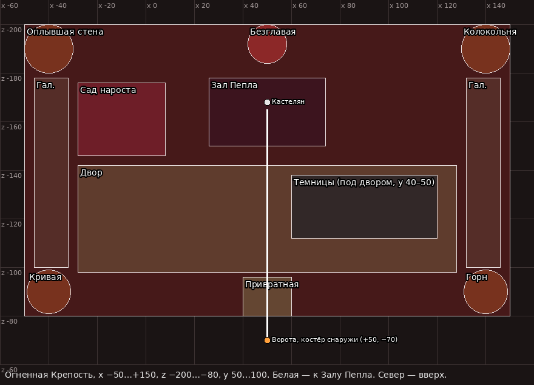
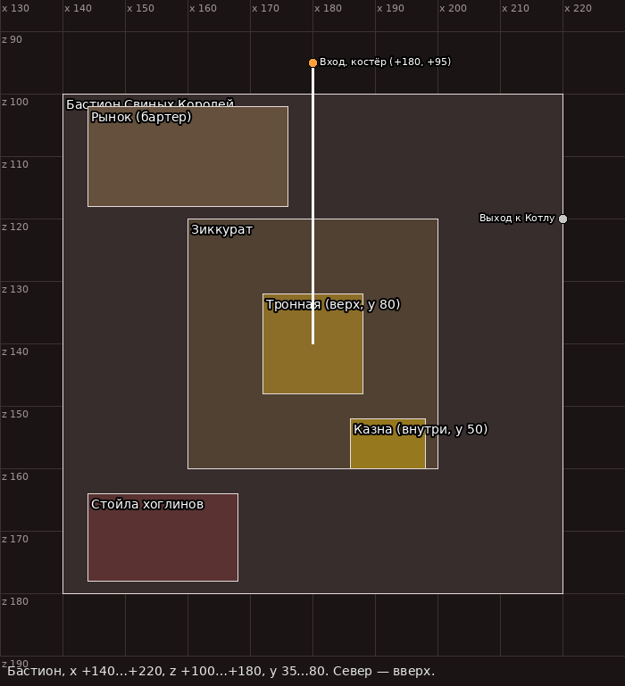
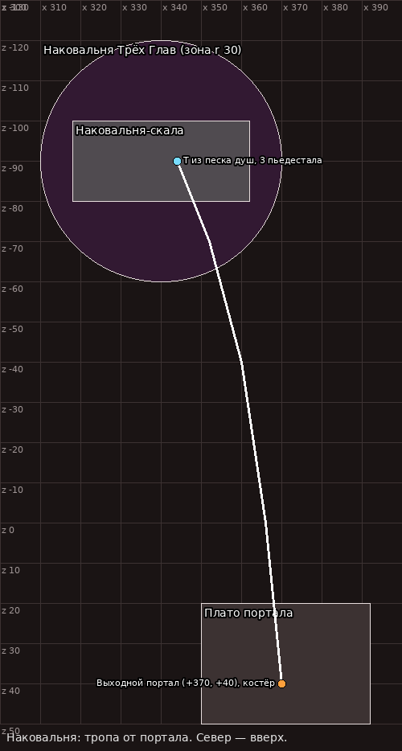

# The Last Ember · Карточки локаций Р6, партия 2

Oct 21, 2026 · Архитектор → Штаб

Р6, партия 2 из 4: три постройки Незера — Огненная Крепость, Бастион Свиных Королей, Наковальня Трёх Глав (Алтарь VI). Все координаты — Незера, раскладка из партии 1 (версия 2).

Версия 2 (21.10): всё принято Штабом, координаты утверждены, ответы внесены (звезда = маяк у врат в Край, незерит под башней Горн, оба пути к Главе Золота, колокол-тревога).

Общее для трёх:

- **Спавн.** Структуры Незера в генерации выключены (T-001), а ванильные огненные духи и иссушённые скелеты появляются только внутри структуры «крепость», брутальные пиглины — только при генерации бастиона. Поэтому все мобы этих построек — спавн датапаком по точкам, с лимитами. Обычные пиглины, зомби-пиглины, хоглины, гасты и лавовые кубы спавнятся ванильно по биомам.
- **Черепа.** Обычные черепа иссушённых скелетов не выпадают (решение Штаба). Три Главы — уникальные предметы.
- **Разрушения.** `mob_griefing false` (T-004) — взрывы иссушителя и гастов блоки не ломают, отдельной защиты арен не нужно.
- **Правило фундамента:** зона включает основание на 5 блоков ниже, у построек над лавой — до уровня лавы.

---

## 1. Огненная Крепость · Р6

**Роль.** Главное подземелье Незера. Огненные духи и иссушённые скелеты. Сад незерского нароста (зелья: здесь «учится» огнестойкость). В Зале Пепла — элитный иссушённый скелет Кастелян, с него — **Глава Пепла**.

**Положение.** x −50…+150, z −200…−80, y 50…100. Стоит на скальной полке северного берега лавового моря. Ворота — на юг, к Северному мосту с острова (0, 0).

**Габариты.** 200×120, стены высотой 24–30, башни до 46 (над полкой). Фундамент уходит в скалу.

**Образ.** Крепость, которую построили, чтобы удержать огонь, а огонь её расплавил. Пять башен, и ни одна не стоит прямо: верхушки оплыли, как свечи, камень стёк потёками по стенам и застыл. Одна башня без верха — срезана, будто чем-то огромным. Внутри — широкий двор, где когда-то строились войска, а теперь бродят чёрные скелеты. На юге, над мостом, — ворота с опущенной решёткой.

**Структура по частям.**

1. **Привратная** (+40…+60, −96…−80): ворота 7×9 с опущенной решёткой из `iron_bars` (поднимается swap при входе команды на мост, рифма с воротами Р5), над ними — галерея стрелков. Перед воротами снаружи — **костёр у ворот Крепости** (+50, −70) (из партии 1).
2. **Внешняя стена** — толщина 4, по верху ход с зубцами. Стена кое-где оплыла: проломы, в которые натекла застывшая «лава» из `magma_block` и `blackstone`.
3. **Пять башен.**
   - **Оплывшая** (−40, −190), r 10 — самая высокая, верх стёк набок, как свеча. Внутри винтовая лестница на стену.
   - **Колокольня** (+140, −190), r 10 — колокол (`bell`) наверху: звонит, если игрок поднимается по лестнице (будит гарнизон, предложение).
   - **Кривая** (−40, −90), r 9 — наклонена внутрь двора.
   - **Горн** (+140, −90), r 9 — внутри лавовый горн во всю высоту, жар; гнездо огненных духов.
   - **Безглавая** (+50, −192), r 8 — за Залом Пепла, верх срезан ровно. С обрыва видно Наковальню вдали.
4. **Двор** (−28…+128, −142…−98) — открытый, плиты из кирпича Незера, два ряда колонн, сгоревшие стойки с оружием (декор). Здесь основная схватка: иссушённые скелеты патрулируют, огненные духи висят над двором.
5. **Галереи** — западная и восточная, крытые, на арках (ванильный образ крепости Незера: мосты из кирпича над пустотой). Соединяют угловые башни.
6. **Сад нароста** (−28…+8, −176…−146) — грядки песка душ с `nether_wart` под навесом, `soul_lantern`. Сундук садовника.
7. **Темницы** (под двором, +60…+120, −138…−112, y 40–50) — ряды камер за `iron_bars`. В одной — скелет гнома-изгнанника и записка; в другой — пиглин-пленник (зомбированный, нейтральный — сценка).
8. **Зал Пепла** (+26…+74, −178…−150) — тронный зал 48×28, высота 18. Две колоннады, в конце — трон из `polished_blackstone` на помосте, над ним — чаша с огнём. Перед входом — площадка с двумя жаровнями (костра нет: от ворот всего 80, решение Штаба по схеме костров Р6).

**Кастелян.** Элитный иссушённый скелет, крупнее обычного (атрибут `scale` ~1,4), с каменным мечом и в почерневших доспехах. Сидит на троне, встаёт, когда команда пересекает середину зала. В бою из двух чаш-горнов по бокам зала появляются огненные духи (по одному в 20 секунд, не больше 2 одновременно). С Кастеляна падает **Глава Пепла** — череп иссушённого скелета, обугленный. Поражение всех — Кастелян садится на трон, здоровье восстанавливается.

**Палитра.**

| Часть | Блоки и доли |
| --- | --- |
| Стены и башни | `nether_bricks` 45%, `cracked_nether_bricks` 20%, `red_nether_bricks` 10%, `blackstone` 15%, `chiseled_nether_bricks` 5%, `magma_block` 5% (потёки) |
| Оплывшие верхушки | градиент сверху вниз: `blackstone` → `basalt` → `magma_block` пятнами → `nether_bricks`; «капли» — свисающие `nether_brick_wall` |
| Двор, полы | `nether_bricks`, `nether_brick_slab`, `polished_blackstone` дорожки |
| Решётки, ограды | `nether_brick_fence`, `iron_bars` |
| Зал Пепла | `polished_blackstone_bricks`, колонны `polished_basalt`, трон `chiseled_polished_blackstone`, чаши — `magma_block` с `fire` в обводе `polished_blackstone_wall` |
| Сад | `soul_sand`, `nether_wart`, навес `crimson_planks` |

**Свой биом.** Нет: ванильный `nether_wastes` (с севера граничит с `crimson_forest`).

**Свет.** Магма в потёках, горн в башне Горн, огонь в чашах Зала, `soul_lantern` в саду (синий островок). Двор — полутьма с красными отсветами.

**Точки для механик.**

- Костёр: у ворот (+50, −70). Перед Залом костра нет (от ворот 80 — решено Штабом, партия 4).
- Решётка ворот — swap.
- Колокол Колокольни — триггер «тревога» (предложение): на 30 секунд +3 иссушённых скелета у двора.
- Спавн датапаком: иссушённые скелеты — 8 точек патрулей двора и галерей (не больше 8 живых); огненные духи — гнездо в Горне и 3 точки над двором (не больше 5 живых).
- Зал Пепла: триггер-зона, трон (точка Кастеляна), 2 чаши-горна (появление духов).
- Сундуки: 4 — сад, темницы, арсенал в Оплывшей, казна Кастеляна за троном.

**Пути.** Северный мост → ворота → двор → Зал Пепла. Вокруг — галереи и башни для исследования. Обратно — тем же путём к острову (0, 0) и дальше на восток к Бастиону. Зона приключения — вся Крепость с полкой и фундаментом (y 45…110).

**«Угасшая» версия.** После победы над Кастеляном спавн во дворе реже (вдвое), огонь в чашах Зала гаснет.

**Нагрузка.** Мобы: до 8 иссушённых скелетов + до 5 огненных духов + Кастелян. Блочные: 4 сундука, колокол, 2 костра. Редстоун: нет.

**Идеи для игры (предложения).**

- Нарост из сада — сундук садовника и грядки (ломать в зоне нельзя). Посадить свой нарост можно на песке душ в Долине душ — там Незер разрушаем.
- Огненные духи — источник огненных стержней: варочная стойка и огнестойкость (нарост + сливки магмы с лавовых кубов).
- Записка гнома в темнице: «Они звали это место Последним Горном. Огонь, который тут держали, не наш».
- Срезанная башня — «что-то огромное» прошло здесь: первый намёк на иссушителя.

**Технические заметки для Claude Code.**

- `.nbt` по сетке 40×40, по высоте — 2 слоя (≤ 48): около 30 кусков. Башни с оплывшими верхами — отдельные шаблоны, ставятся поверх.
- Иссушённые скелеты и огненные духи — только спавн датапаком (ванилла их здесь не даст: структуры нет).
- Глава Пепла — уникальный предмет (см. Наковальню), выпадает только с Кастеляна, один на команду.

**Референсы.** Рамки (Р6: Харренхолл — замок, оплавленный огнём; ванильная крепость Незера — кирпич, мосты на арках).

---

## 2. Бастион Свиных Королей · Р6

**Роль.** Бартер с пиглинами (здесь «учится» золото и обмен), ценный лут, **Глава Золота** — трофей Свиного Короля.

**Положение.** x +140…+220, z +100…+180, y 35…80. На южном берегу лавового моря, к югу — Долина душ. Вход с севера, от моста (+100, 0) → (+180, +95). Выход на восток — к Котлу.

**Габариты.** 80×80, высота 45 (зиккурат). Фундамент — 5 вниз в базальт.

**Образ.** Ступенчатая гора из чернокамня, обвешанная золотом, как идол. Внизу — рынок под навесами, где пиглины торгуются и дерутся, сбоку вонючие стойла с хоглинами. Наверху, на последней ступени, под балдахином из цепей — трон, и на нём огромный пиглин в золотой короне, с черепом на поясе.

**Структура по частям.**

1. **Вход** — ворота с северной стороны, у (+180, +100). Снаружи — **костёр у входа в Бастион** (+180, +95).
2. **Рынок** (+144…+176, +102…+118) — навесы на `chain`, прилавки, золотые блоки в декоре. Здесь бродят пиглины, готовые к бартеру.
3. **Зиккурат** (+160…+200, +120…+160) — четыре ступени, на каждую — лестница по оси. Внутри ступеней — казармы брутальных пиглинов, кладовые.
4. **Тронная** (верх, +172…+188, +132…+148, y 80) — открытая площадка, трон из `gilded_blackstone` и `gold_block`, балдахин из цепей. Свиной Король.
5. **Казна** (внутри зиккурата, +186…+198, +152…+160, y 50) — сундуки с золотом и ценным лутом (ванильный бастион), охрана — 2 брутальных пиглина.
6. **Стойла хоглинов** (+144…+168, +164…+178) — загоны, 4 хоглина. Ворота загонов можно открыть — хоглины выбегут на тех, кто рядом.
7. **Восточный выход** — тропа к мосту на Котёл (+220, +120).

**Свиной Король и Глава Золота (принято Штабом — оба пути).**

- **Дань.** Все игроки в команде носят хотя бы один золотой предмет (ванилла: тогда пиглины не нападают), и кто-то кладёт в чашу у трона золотой блок. Король встаёт, снимает череп с пояса и бросает его к ногам. Без боя — для команды, которая пришла подготовленной.
- **Бой.** Если кто-то без золота, кто-то ударил пиглина или открыл сундук Казны (ванилла: пиглины злятся на вскрытие сундуков) — Король идёт в бой. Он крупный (`scale` ~1,6), с золотым топором, медленный, бьёт по площади. С ним — до 3 брутальных пиглинов. С Короля падает Глава Золота.
- Поражение всех в бою — Король возвращается на трон, путь дани остаётся открытым.

**Палитра.**

| Часть | Блоки и доли |
| --- | --- |
| Зиккурат, стены | `polished_blackstone_bricks` 40%, `blackstone` 25%, `cracked_polished_blackstone_bricks` 15%, `basalt` 10%, `gilded_blackstone` 10% |
| Золото (только в зоне) | `gold_block` — трон, чаша, 6–8 блоков на рынке; `gilded_blackstone`; `chain` |
| Рынок | навесы `crimson_planks` и `chain`, прилавки `crimson_slab` |
| Стойла | `nether_brick_fence`, `soul_soil`, `crimson_nylium` |
| Казна | `polished_blackstone`, `gold_block` в нишах |

**Свой биом.** Нет: ванильные `nether_wastes` на севере, `soul_sand_valley` на юге (стойла смотрят в Долину душ).

**Свет.** Лава в каналах вдоль ступеней (за `iron_bars`), `lantern` на рынке, у трона — `shroomlight` в золотых нишах (тёплый жёлтый на фоне багрового).

**Точки для механик.**

- Костёр у входа (+180, +95).
- Чаша дани у трона — точка проверки золотого блока.
- Трон — точка Короля; триггер «бой» (удар по пиглину, сундук Казны, игрок без золота на верхней ступени).
- Спавн датапаком: брутальные пиглины — 4 точки в казармах (не больше 3 живых + 2 у Казны). Обычные пиглины на рынке — 6–8 постоянных.
- Ворота стойл — swap.
- Сундуки: Казна (2), казармы (1), рынок (1).

**Пути.** Вход с севера → рынок → лестницы зиккурата → тронная. Казна — через внутренние ходы. Восточный выход → мост на Котёл. Зона приключения — весь Бастион с фундаментом.

**«Угасшая» версия.** После дани или победы Король сидит без черепа (или трон пуст). Бартер на рынке работает дальше.

**Нагрузка.** Мобы: 6–8 пиглинов + до 5 брутальных + Король + 4 хоглина. Сущности: нет. Блочные: 4 сундука, костёр.

**Идеи для игры (предложения).**

- Бартер — ванильный (рамки), сюда приходят за огнестойкостью и жемчугом. Золото — из Шахт Предков (Р5): глава учит, что золото пригодится.
- Пленник Крепости (зомбированный пиглин в темнице) — родственник Короля: записка на пиглинском (картинками) — Король даст скидку на дань (например, слитки вместо блока), если принести его жетон.
- На стене тронной — фреска: огромный трёхглавый зверь и пиглины, бегущие от него. Король хранит один из черепов как трофей.

**Технические заметки для Claude Code.**

- `.nbt` 4 куска 40×40×48 по четвертям.
- Брутальные пиглины — только датапаком. Обычные пиглины нейтральны к игроку в золоте — это ванилла, работает на каждого игрока отдельно.
- Если у команды нет золота вовсе, путь дани закрыт — остаётся бой. Количество золота для дани — по экономике Штаба.

**Референсы.** Рамки (Р6: бастион, пиглины, бартер; ванильный бастион — палитра и казна).

---

## 3. Наковальня Трёх Глав · Р6, Алтарь VI

**Роль.** Алтарь VI. Три Главы на песке душ — призыв иссушителя. Победа даёт звезду Незера — ключ к вратам в Край на вершине Пепельной горы.

**Положение.** Скала в лаве, центр (+340, −90), зона — цилиндр r 30, y 30…110. От выходного портала (+370, +40) к ней ведёт тропа на север, около 140 блоков.

**Габариты.** Скала-наковальня 44×20 по верху, высота над лавой ~30 (верх y 62). Вокруг — кольцо уступов на y 48, ширина 6.

**Образ.** Одинокая скала посреди лавы, по очертаниям — наковальня: широкая плоская вершина, рог на запад, узкая «талия» к низу. На вершине — Т из песка душ, на которой не хватает трёх голов. Сюда ковали что-то, чего не должно было быть. Тропа с плато портала идёт по базальтовым гребням над лавой, и на всём её протяжении скала видна впереди.

**Структура по частям.**

1. **Тропа** с плато выходного портала: гребни `basalt` ширина 3–5, два коротких моста. Костёр у выходного портала (+370, +40) — он же костёр перед ареной (~140 по тропе).
2. **Кольцо уступов** y 48 вокруг скалы: базальтовые полки, 4 лестницы на вершину. Укрытия от черепов иссушителя.
3. **Вершина** y 62, 44×20: ровная площадка из `polished_blackstone`, на краях — 6 столпов `polished_basalt` с цепями к своду (держат «наковальню» над огнём).
4. **Т из песка душ** в центре — 4 блока `soul_sand` (ножка и перекладина), над перекладиной — три места под Главы. Ножка смотрит на юг, к порталу.
5. **Рог** — западный выступ вершины: обзорная точка на лавовое море и Крепость.

**Призыв.** Игрок ставит Главу на её место (клик по пьедесталу: Главы не обычные черепа, а предметы, которые нельзя поставить как блок; так иссушителя нельзя вызвать в другом месте). Датапак ставит череп-блок, повёрнутый к месту, откуда Глава принесена (правило алтарей: Пепла — на запад-северо-запад к Крепости, Золота — на запад-юго-запад к Бастиону, Света — на юг-юго-восток к порталу и Городу). Когда все три на месте — гул, Т вспыхивает, датапак проводит призыв иссушителя (появление с ванильной анимацией набора здоровья).

**Бой.** Ванильный иссушитель. Арена ограничена `barrier`-цилиндром r 30 до свода (y 110), чтобы он не улетел. Падение с вершины — на кольцо уступов (не смерть), с уступов — в лаву (смерть, след в Урну). Поражение всех — иссушитель исчезает, Главы остаются на местах, призыв можно повторить.

**Победа.** Звезда Незера (одна на команду). Т из песка душ гаснет, Главы рассыпаются пеплом. Пепел в воздухе над скалой — тише.

**Палитра.**

| Часть | Блоки и доли |
| --- | --- |
| Скала | `basalt` 45%, `blackstone` 30%, `smooth_basalt` 15%, `magma_block` 10% (трещины) |
| Вершина | `polished_blackstone` 60%, `polished_blackstone_bricks` 30%, `chiseled_polished_blackstone` 10% (узор по краю) |
| Т | `soul_sand`, вокруг рамка `soul_soil` |
| Столпы и цепи | `polished_basalt`, `chain` |
| Тропа | `basalt`, `blackstone` |

**Свой биом.** Нет: ванильный `basalt_deltas`.

**Свет.** Лава снизу, магма в трещинах. На вершине — 4 `soul_campfire` (декор, не номерные) по углам Т — синий свет, рифма с огнём души в Котле.

**Точки для механик.**

- Три пьедестала Глав (над каждым — место под череп-блок), триггер «все три».
- Точка появления иссушителя — над Т, y 66.
- `barrier`-цилиндр r 30, y 30…110.
- Костёр — у выходного портала.

**Пути.** Плато портала → тропа → кольцо → вершина. Обратно — той же тропой к порталу и на поверхность, к вершине Пепельной горы. Зона приключения — весь цилиндр.

**«Угасшая» версия.** После победы: Т тёмная, Главы — пепел, столпы целы.

**Нагрузка.** Сущности: иссушитель, 3 череп-блока, 3 `interaction` у пьедесталов. Блочные: 4 декоративных костра.

**Идеи для игры (предложения).**

- Трёхглавый «зверь» с фрески Бастиона и срезанная башня Крепости — иссушителя уже вызывали однажды. Записка у Т: «Мы ковали щит от огня. Получился огонь, у которого три головы».
- Звезда Незера как ключ: на вершине Пепельной горы — пирамида маяка, звезда становится маяком, луч открывает врата (см. вопрос 1).

**Технические заметки для Claude Code.**

- Скала — 2 куска `.nbt` (44×20×48 по высоте разбить на 2). Тропа — скриптом.
- Главы — уникальные предметы с `item_model` черепа; ставит черепа датапак. Обычные черепа иссушённых скелетов из мира не выпадают (решение Штаба).
- Иссушитель в 26.3 — проверить по игре, ломает ли он блоки при `mob_griefing false` (по ванилле не должен) и держит ли его `barrier`.

**Референсы.** Рамки (Р6: Наковальня Трёх Глав, звезда — ключ к финалу; ванильный призыв иссушителя).

---

## Решено Штабом

1. **Звезда и маяк — одно.** У врат в Край на вершине Пепельной горы — готовая пирамида маяка (в неразрушимой зоне, металл можно). Звезда с иссушителя становится маяком, луч открывает врата. Вторая звезда не нужна. Пирамида — в партии 4.
2. **Незерит.** 8 `ancient_debris` (2 слитка) в разрушаемом кармане под башней Горн, за стеной зоны, с подсказкой — жар и трещины в стене. Карман: под Горном (+140, −90), y 40–46, 6×6×5, вход — пролом в фундаменте снаружи стены с восточной стороны, трещины `cracked_nether_bricks` и `magma_block` пятнами, из щелей — частицы дыма. Шаблон улучшения незерита — 1, в Казне Бастиона (размножается алмазами по ванильному рецепту).
3. **Свиной Король — оба пути.** Дань — золотой блок в чашу, все игроки в золоте. Жетон родственника из темницы Крепости снижает дань до 4 слитков.
4. **Колокол Колокольни** — тревога с подкреплением.
5. Идеи и «угасшие» версии всех трёх приняты. Для билдера: проверить `barrier` для иссушителя и `mob_griefing false`.
