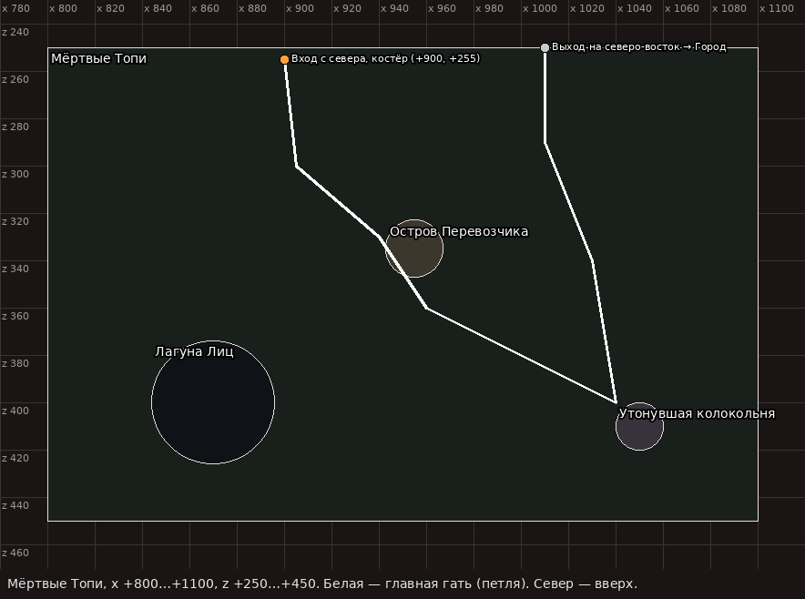
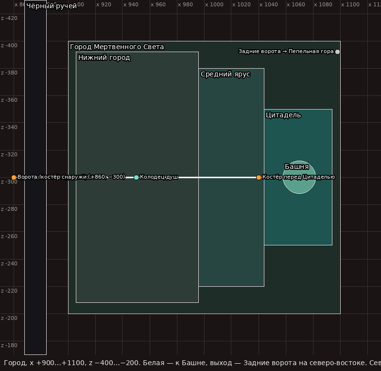

# The Last Ember · Карточки локаций Р6, партия 3

Oct 21, 2026 · Архитектор → Штаб

Р6, партия 3 из 4: верхний мир — Пепельная Пустошь (основная территория), Мёртвые Топи (необязательная петля), Город Мертвенного Света (последняя крепость врага, Глава Света). Координаты верхнего мира. Раскладка — партия 1 (версия 2), план поверхности `../schemes/r6_surface_plan.png`.

Цвета, туман и звуки трёх биомов здесь — намерение. Точные значения записывает реестр биомов (`docs/design/biomes/registry.md`), его ведёт отдельная сессия.

---

## 1. Пепельная Пустошь · Р6, свой биом

**Роль.** Основная территория Р6: всё, что не Топи, Город и гора. Переход от Пепельных Врат к Городу и дальше к вулкану. Здесь «учится» читать регион без ориентира на глаз: гул вулкана, фреска, пепел (решено в партии 1).

**Положение.** x +665…+1500, z −870…+650, кроме Топей, Города и подножия горы. С запада — Обугленный хребет, с севера — Стена, с юга — Ржавый Разлом с пеплом на дне.

**Габариты.** ~835×1520, около 1 млн блоков площади. Рельеф — ванильный сида 10845, поверхность перекрашивается скриптом.

**Образ.** Земля, на которую упало солнце. Серая равнина без травы, пепел лежит, как снег, и всё время падает с красно-бурого неба. Холмы — горбы пепла, из которых торчат чёрные стволы. По равнине тянутся трещины, в глубине которых светится лава. Вдали гудит то, чего не видно. Это мир после пожара, который никто не тушил.

**Рельеф и поверхность.**

1. **Поверхность** — скрипт перекрашивает верхние 3–4 блока рельефа сида: пепел вместо травы и земли, туф и базальт вместо камня на склонах. Деревья сида заменяются обугленными стволами (или вырубаются; 1 обугленный на 4–6 исходных).
2. **Пепельные дюны** — на ровных участках волны высотой 1–3 из `light_gray_concrete_powder` и `gray_concrete_powder` поверх `tuff`.
3. **Лавовые трещины** — 6–8 трещин длиной 40–120, ширина 2–4, глубина до 8: внизу лава, края — `magma_block` и `basalt`. Пересекают путь, но переходимы по каменным перемычкам. Свет ночью.
4. **Базальтовые столбы** — группы `basalt` 3–12 в высоту, как застывшие струи. Места для засад и ориентиры на местности.
5. **Тракт Пепла** — старая дорога от Пепельных Врат к Городу (основной путь, ~360): колея из `coarse_dirt` и `gravel` под пеплом, вешки — столбы `polished_blackstone` с черепами (`skeleton_skull`) через 30, обугленные телеги, виселица на развилке к Топям.
6. **Пепельные кратеры** — 3–4 воронки r 8–15: дно из `obsidian` и `crying_obsidian` («сюда падали искры солнца»). Пустые или с сундуком мародёра (общий лут).

**Палитра.**

| Часть | Блоки и доли |
| --- | --- |
| Поверхность равнины | `gray_concrete_powder` 30%, `light_gray_concrete_powder` 20%, `tuff` 20%, `gravel` 10%, `coarse_dirt` 10%, `basalt` 10% |
| Склоны и скалы | `tuff` 35%, `basalt` 25%, `smooth_basalt` 15%, `blackstone` 15%, `andesite` 10% |
| Обугленные деревья | ствол `dark_oak_log` и `basalt` (верх сгорел), ветви `blackstone_wall`, без листвы. Высота 4–9 |
| Трещины | `lava` на дне, края `magma_block` 40%, `basalt` 40%, `blackstone` 20% |
| Кратеры | `obsidian` 60%, `crying_obsidian` 15%, `blackstone` 25% |
| Растения | `dead_bush`, редкие `wither_rose` у кратеров (вне Города — только 3–5 штук, это лор, не ферма) |

**Свой биом «Пепельная Пустошь»** (рамки).

| Что | Намерение |
| --- | --- |
| Небо | красно-бурое |
| Туман | пепельно-серый, плотный (видимость в нём — около 100–120, гул вулкана нужнее, чем глаз) |
| Вода | серая |
| Частицы | `white_ash` густо — пепел как снег |
| Осадки | нет (дождя в Пустоши не бывает, вместо него пепел) |
| Звуки | ветер, далёкий рокот; гул вулкана — отдельный скрипт (партия 1) |
| Сон | запрещён, как в других опасных биомах (если реестр решит так же) |
| Спавн | кадавры (`husk` — не горят на солнце, «пепельные»), скелеты, ведьмы — редко; элитная нежить у Тракта (лимит Штаба) |

**Свет.** Днём — тусклый свет сквозь пепел. Ночью — только лава в трещинах и красная луна. Вешки Тракта без света: в темноте путь держат по трещинам и гулу.

**Точки для механик.**

- Гул вулкана — из партии 1.
- Тракт Пепла: 12 вешек; виселица на развилке к Топям (+880, +150) — табличка «К Перевозчику».
- Кратеры — 3–4 точки сундуков мародёров.
- Костёр на Тракте (+850, −150) — «Вешка», около 175 от Врат (≤ 350 до ворот Города). Итог — в схеме костров партии 4.

**Пути.** Врата → Тракт Пепла → ворота Города. Развилка (+880, +150) на юг к Топям. Зоны приключения: только костры и постройки. Пустошь разрушаема.

**«Угасшая» версия.** Нет (Р6 — последняя глава перед финалом). Предлагаю вместо неё: после призыва иссушителя туман Пустоши густеет, а гул учащается — мир торопит к вершине (по желанию Штаба).

**Нагрузка.** Мобы — ванильный спавн биома, лимит Штаба. Блочные: сундуки кратеров (3–4). Сущности: нет.

**Идеи для игры (предложения).**

- Обугленные телеги на Тракте — остатки обоза Несущих, которые шли к Городу «за светом» и остались. Записки по пути: «В Городе горит свет. Настоящий. Мы видели с холма». Ближе к Городу: «Это не тот свет».
- Пепельные кадавры выбираются из дюн, если по ним бежать (рядом с игроком, со звуком осыпи).
- Мечи павших Несущих Р6 (партия 4) — у трещин и у кратеров.

**Технические заметки для Claude Code.**

- Поверхность — скриптом по высотам сида (как для Р1–Р4), `fillbiome` по контуру региона минус Топи и Город.
- Порошок бетона — сыпучий: класть только на твёрдое, не над пустотами пещер (проверить при перекраске). В воде он превращается в бетон — у луж и озёр сида заменить на `tuff` или осушить.
- Ванильные деревья сида — заменять шаблонами обугленных стволов (3–4 шаблона).

**Референсы.** Рамки (Р6: Мордор, «пепел вместо снега», вулкан на горизонте).

---

## 2. Мёртвые Топи · Р6

**Роль.** Необязательная петля к югу от Врат (решено Штабом): переход с опасной водой по узким гатям, скрытый торговец Перевозчик, сокровищница «Утонувшая колокольня», лор — лица под водой.

**Положение.** x +800…+1100, z +250…+450, уровень воды — по рельефу сида (низина), глубина 2–5.

**Габариты.** 300×200. Гати — общая длина около 450, ширина 1–2.

**Образ.** Чёрная неподвижная вода до горизонта, туман низко над ней. Из воды торчат мёртвые деревья с корнями, похожими на пальцы. Под водой, на глубине, горят бледные огоньки — и если присмотреться, это лица: черепа, головы, выложенные на дне, все смотрят вверх. По воде — узкие мостки из чёрных досок, местами провалившиеся. Посреди — островок с хижиной и лодкой, а на дальнем краю из воды торчит верх колокольни.

**Структура по частям.**

1. **Вход с севера** (+900, +255) — от развилки Тракта. **Костёр Топей** на твёрдом берегу.
2. **Главная гать** — петля: вход → Остров Перевозчика → Утонувшая колокольня → обратно на север к выходу на северо-восток (+1010, +250), откуда пунктир к Городу. Мостки шириной 1–2 из `dark_oak_planks` и `mangrove_planks` на сваях `mangrove_roots`. 5–6 мест, где досок нет (разрыв 1–2, прыжок), 3 места, где доски проваливаются под игроком (swap с откатом: доски уходят под воду через секунду после шага, через 20 секунд возвращаются).
3. **Лагуна Лиц** (+870, +400), r 26 — самое глубокое место (5). Дно выложено черепами и головами, между ними — огоньки. Сюда с гати не идут, но её видно с мостков: это главный кадр Топей.
4. **Остров Перевозчика** (+955, +335), r 12 — хижина на сваях, лодка у причала. Скрытый торговец.
5. **Утонувшая колокольня** (+1050, +410), r 10 — сокровищница (см. ниже).
6. **Мёртвые деревья** — 30–40 мангровых остовов без листвы, корни над водой.

**Опасная вода (предложение).** Вода не убивает сама, но в ней:

- через 2 секунды — замедление и усталость (тянут вниз);
- через 6 секунд — иссушение I, пока игрок в воде;
- из воды поднимаются утопленники (спавн биома), чаще ночью.

Упавший с гати выбирается на мостки за 2–4 секунды — это страх, не смерть. Лодка Перевозчика — безопасный способ пересечь Топи (вода не действует на тех, кто в лодке).

**Перевозчик (скрытый торговец, предложение).** Старик в капюшоне, на острове, «возит души туда, где их ждут». Найти: развилка с табличкой у виселицы → гать → остров. Товар — решает Штаб (по смыслу: огнестойкость, лодки, карта Р6 с отметкой Скита Монаха). Пускает в лодку и довозит до выхода на северо-восток. В таблицу торговцев рамок он не входит — предлагаю добавить второго торговца Р6 (Штаб упомянул торговца в Топях).

**Сокровищница «Утонувшая колокольня» (предложение).**

- **Место.** Колокольня часовни, которая ушла в топь: над водой — верх башни 6×6 высотой 8, проём колокольни. Сама часовня — под водой, 14×10, глубина 6–10 под поверхностью (ниже дна Топей — вырыто).
- **Вход.** С гати — в проём колокольни, вниз по верёвке (`chain`/лестница) в затопленную башню, затем — в затопленную часовню: воздушные карманы под сводом (по 2–3 блока воздуха каждые 8–10 блоков).
- **Хозяин.** Утопленный Звонарь — элитный утопленник с трезубцем. Когда игрок входит в часовню, колокол наверху звонит (сам), и Звонарь поднимается из-под алтаря.
- **Сундук.** За алтарём часовни, в воздушном кармане.
- **Подсказки.** Записка на Острове Перевозчика: «Иногда по ночам звонит колокол, хотя его никто не трогает»; звон колокола слышен с гати ночью (раз в 1–2 минуты, если игрок в Топях).
- В затопленной часовне вода обычная (не «опасная») — чтобы бой под водой был честным.

**Палитра.**

| Часть | Блоки и доли |
| --- | --- |
| Берега, кочки | `mud` 35%, `muddy_mangrove_roots` 20%, `gray_concrete_powder` 15% (пепел на кочках), `soul_soil` 15%, `tuff` 15% |
| Гать | `dark_oak_planks` 50%, `mangrove_planks` 30%, `dark_oak_slab` 20%, сваи `mangrove_roots`, `dark_oak_fence` |
| Дно | `mud` 60%, `soul_soil` 25%, `gravel` 15% |
| Лица под водой | `skeleton_skull` 60%, `zombie_head` 40%, все «лицом вверх»; между ними `sea_pickle` и `glow_lichen` |
| Деревья | `mangrove_log`, `mangrove_roots`, без листьев |
| Хижина Перевозчика | `spruce_planks`, `dark_oak_log`, крыша `mud_bricks` и `dark_oak_stairs`, `lantern` |
| Колокольня | `mud_bricks`, `mossy_stone_bricks`, `cracked_stone_bricks`, `bell`; затопленная часовня — `stone_bricks`, `mossy_stone_bricks` |

**Свой биом «Мёртвые Топи»** (рамки).

| Что | Намерение |
| --- | --- |
| Вода | чёрная, подводный туман тёмный и короткий |
| Небо и туман | как Пустошь, но туман ниже и плотнее, зеленовато-серый у воды |
| Частицы | редкие `soul` над водой (огоньки) |
| Звуки | бульканье, капли, далёкий колокол — по скрипту |
| Спавн | утопленники, ведьмы, слизни (вода, болото), без кадавров |

**Свет.** Над водой — темно. Под водой — бледные огоньки (`sea_pickle`, `glow_lichen`, частицы `soul`). Хижина — один фонарь. Сочетание даёт главный эффект: свет снизу, а не сверху.

**Точки для механик.**

- Костёр Топей (+900, +255).
- 3 проваливающихся участка гати — swap с откатом.
- Зона «опасная вода»: контур Топей минус часовня; проверка игрока в воде раз в 10 тиков.
- Перевозчик: точка торговца, лодка (2 точки — причал острова и выход).
- Колокол: звон ночью; триггер часовни — появление Звонаря; сундук сокровищницы.

**Пути.** Вход с севера → гать → остров → колокольня → выход на северо-восток к Городу (или обратно на Тракт). Лодка Перевозчика — короткий путь. Зоны приключения: хижина с островом, колокольня с часовней и фундаментом, костёр, гать (полоса 3 по оси, чтобы мостки нельзя было достроить).

**«Угасшая» версия.** Нет.

**Нагрузка.** Мобы: утопленники до 6, ведьмы до 2. Сущности: лодка, торговец. Блочные: колокол, сундук сокровищницы, сундук Перевозчика, ~120 черепов и голов — блоки, не сущности (дёшево).

**Идеи для игры (предложения).**

- «Мир смотрит»: Лагуна Лиц — самое прямое «лица под водой» в игре. Если долго смотреть на неё с гати, одна голова медленно поворачивается к игроку (swap поворота черепа).
- Перевозчик знает Советчика: «Он тоже заходил. Говорил, что вы придёте втроём». (Тонкий намёк для «Отдать».)
- Лодка Перевозчика может довезти и до Лагуны — туда только так.

**Технические заметки для Claude Code.**

- Топи — скриптом по рельефу сида: вода на уровень низины, дно, гать по полилинии. Остров, хижина, колокольня с часовней — `.nbt` (колокольня + часовня 14×10×20 — 1 кусок).
- Иссушение от воды — эффект скриптом, не урон: игрок видит причину (чёрные сердца).
- **Только `skeleton_skull`, `zombie_head` и т. п. — никаких `wither_skeleton_skull` в мире вне Наковальни** (решение Штаба про черепа).
- Утопленники с трезубцами: трезубец — не металл, ванильный дроп оставить? Решает экономика.

**Референсы.** Рамки (Р6: Мёртвые топи — огни и лица под водой, узкие гати).

---

## 3. Город Мертвенного Света · Р6

**Роль.** Последняя крепость врага. Ключевой предмет Р6 — **Глава Света**. Город перекрывает путь к Пепельной горе: выход к вулкану — через его Задние ворота.

**Положение.** x +900…+1100, z −400…−200, на склоне перед подножием горы: западный край ниже, восточный выше (перепад 20–30). Ворота — на запад, к Тракту Пепла. Задние ворота — северо-восточный угол (+1098, −392), к склонам горы.

**Габариты.** 200×200, стены высотой 16–20, Башня — 24×24 у основания, высота ~95 над Цитаделью.

**Образ.** Город, в котором свет есть — и это хуже темноты. Из-за чёрного ручья через мост с бледными цветами видны стены, и над всем — Башня, вершина которой горит зелёно-голубым. Свет не греет и не отбрасывает тёплых теней: он мертвенный, как от гнилушек. Улицы освещены синими огнями душ, в окнах — зелёный отсвет. Здесь остались те, кто решил, что солнце можно заменить. Их лампа — на вершине Башни, и в ней горит третья голова.

**Структура по частям.**

1. **Чёрный ручей** (x +868…+884) — поток с запада, вода биома (чёрная), с бледными цветами по берегам (`lily_of_the_valley`, `azure_bluet`, `white_tulip` — мертвенно-бледные в зелёном свете). Без «опасной» воды Топей.
2. **Мост Бледных Цветов** — каменный мост 5×20 через ручей, на перилах — цветы в горшках, статуи без лиц. Перед мостом — **костёр у ворот Города** (+860, −300).
3. **Ворота** — арка 9×14 в западной стене, створки открыты: город не боится гостей. Над аркой — лицо, вырезанное в камне, глаза светятся (`verdant_froglight`).
4. **Нижний город** (+906…+996) — плотные кварталы: 2–3-этажные дома из чёрного камня, улицы 3–5, фонари душ. Лестницы вверх к ярусу. В центре — **Колодец душ** (+950, −300): круглая площадь, в колодце — огонь души внизу, на дне, а не вода.
5. **Средний ярус** (+996…+1044) — выше на 10, отделён внутренней стеной: храмы-«часовни света», казармы гарнизона, библиотека с записями о «новом солнце».
6. **Цитадель** (+1044…+1094, −350…−250) — ещё на 10 выше, своя стена, ворота. Перед воротами — **костёр перед Цитаделью** (+1040, −300).
7. **Башня Мертвенного Света** (+1070, −300), основание 24×24, сужается кверху до 12×12. Подъём — винтовая лестница внутри, 6 этажей-ярусов с площадками (на 3-м и 5-м — бой), наверху — **Лампа**: открытая площадка, в центре — чаша, в которой огнём души горит Глава Света.
8. **Задние ворота** (+1098, −392) — узкие, за Цитаделью, на тропу к склонам горы. Закрыты, пока Лампа горит (swap после взятия Главы).

**Хранитель Лампы (предложение).** На вершине Башни — элитный бывший Несущий: скелет-маг (ванильный скелет без лука, с нашим снаряжением и моделью), в обгоревших одеждах, с посохом. Он «поддерживает огонь». Бьёт вспышками света: ослепление на 3 секунды и призыв 2 «светлячков» — вексов с моделью зелёного огонька. Победа — Глава Света остаётся в чаше, её можно взять. Поражение всех — Хранитель восстанавливается. Площадка Лампы 18×18, по краям — зубцы, падение = смерть (высота ~95).

**Когда Главу берут** — Лампа гаснет. Весь Город погружается в темноту: фонари гаснут один за другим от вершины вниз по улицам (swap «угасшей» версии). Гарнизон — элитная нежить — выходит на улицы. Спуск с Башни и путь к Задним воротам — уже в темноте и с погоней. Задние ворота открываются.

**Палитра.**

| Часть | Блоки и доли |
| --- | --- |
| Стены и дома | `polished_blackstone_bricks` 35%, `deepslate_bricks` 20%, `blackstone` 15%, `cracked_polished_blackstone_bricks` 10%, `deepslate_tiles` 10%, `dark_prismarine` 10% (пояса, наличники — «призрачный зелёный», рамки) |
| Крыши | `deepslate_tile_stairs`, `blackstone_stairs`, коньки `dark_prismarine_slab` |
| Улицы | `polished_blackstone`, `deepslate_tiles`, `soul_soil` в щелях |
| Башня | `polished_blackstone_bricks` 45%, `dark_prismarine` 25%, `polished_deepslate` 20%, окна — `iron_bars` и `green_stained_glass_pane` 10% |
| Лампа | чаша `polished_blackstone` на `chiseled_polished_blackstone`, огонь — `soul_fire` на `soul_soil`, вокруг — `verdant_froglight` |
| Свет города | `soul_lantern` 60%, `soul_torch` 20%, `verdant_froglight` 10% (окна), `sea_lantern` 10% (храмы) |
| Цветы | `lily_of_the_valley`, `azure_bluet`, `white_tulip` |

**Свой биом «Город Мертвенного Света»** (рамки).

| Что | Намерение |
| --- | --- |
| Небо | почти чёрное |
| Туман | зеленовато-серый |
| Частицы | зелёные искры (если в реестре есть подходящая — `glow` или `happy_villager` редко; решает реестр) |
| Атрибут света | `block_light_tint` зеленоватый (как в склепах Р1): даже факелы игрока горят мертвенно |
| Сон | запрещён |
| Спавн | ванильный — только скелеты и зомби редко; гарнизон — датапаком |
| Угасание | после взятия Главы: туман темнеет, небо чёрное, `block_light_tint` гаснет (через `fillbiome` на «угасший» вариант биома) |

**Свет.** Пока Лампа горит — весь Город в холодном зелёно-синем свете, светлее, чем Пустошь. После — темнота, только огонь души в Колодце внизу.

**Точки для механик.**

- Костры: у ворот (+860, −300), перед Цитаделью (+1040, −300).
- Башня: ярусы 3 и 5 — точки боя (гарнизон, по 3–4); площадка Лампы — триггер Хранителя, чаша — Глава Света.
- Swap «угасшего» Города: свет (фонари → без света), по частям от Башни вниз, за 30–40 секунд.
- Задние ворота — swap.
- Спавн гарнизона: до Лампы — 6–8 патрулей в Нижнем городе и ярусе; после — до 12 элиток, идут к Башне.
- Сундуки: 4 — библиотека, казармы, храм, кладовая Цитадели.

**Пути.** Тракт → костёр → мост → ворота → Нижний город → ярус → Цитадель → Башня → Лампа → (темнота) → Задние ворота → склоны горы. Зона приключения — весь Город со стенами и фундаментом (y по рельефу −5 … вершина Башни +5), ручей с мостом.

**«Угасшая» версия.** Да — это главная сцена: Город после Лампы. Клон «угасшей» версии подменяет освещение (фонари без огня, окна без froglight), биом — на тёмный вариант.

**Нагрузка.** Мобы: до 8 патрулей + Хранитель + 2 «светлячка»; после Лампы — до 12. Блочные: 4 сундука, ~200 фонарей (блоки, не сущности). Сущности: нет.

**Идеи для игры (предложения).**

- Записи библиотеки: «Мы не стали ждать, пока Несущие дойдут до Кузни. Мы зажгли своё солнце из того, что было под рукой». «Третья голова светит дольше, чем мы думали».
- Обитатели Города — бывшие Несущие, принявшие ложный свет. Рифма с концовками: здесь видно, что бывает, если «отдать» огонь не туда.
- Колодец душ в Нижнем городе — бросить в него что-нибудь: снизу на миг поднимается лицо (мир смотрит).
- Город после Лампы — побег в темноте с Уголём как единственным тёплым светом (носитель держит Уголь — он светится? решает Штаб/билдер).

**Технические заметки для Claude Code.**

- `.nbt`: кварталы Нижнего города — 6–8 шаблонов домов, расставить скриптом по улицам; стены — скриптом; Цитадель — 4 куска 25×50; Башня — 3 куска по высоте (24×24×32).
- «Угасший» Город — одна функция swap света по слоям (фонари `soul_lantern` → `chain`/пусто, `verdant_froglight` → `polished_blackstone`) от Башни вниз, `fillbiome` на тёмный вариант.
- `block_light_tint` — атрибут биома (T-006: 49 атрибутов задаются в биоме).

**Референсы.** Рамки (Р6: Минас-Моргул — город мертвенного света, мост с бледными цветами, башня со светом).

---

## Открытые вопросы

1. **Кто враг в Городе.** Предлагаю: бывшие Несущие, которые решили не нести Уголь к Кузне, а зажечь «своё солнце» из третьей головы. Хранитель Лампы — их последний. Подходит, или у Штаба другой враг для «последней крепости»?
2. **Перевозчик** — второй скрытый торговец Р6 (в таблице рамок только Пепельный Монах). Добавляем?
3. **Опасная вода Топей** — замедление, усталость, иссушение I, без мгновенной смерти. Подходит по силе?
4. **Побег из угасшего Города** — 12 элиток после взятия Главы: это главный «жуть»-момент Р6 перед горой. Не перебор для 2–3 игроков? Можно 8.
