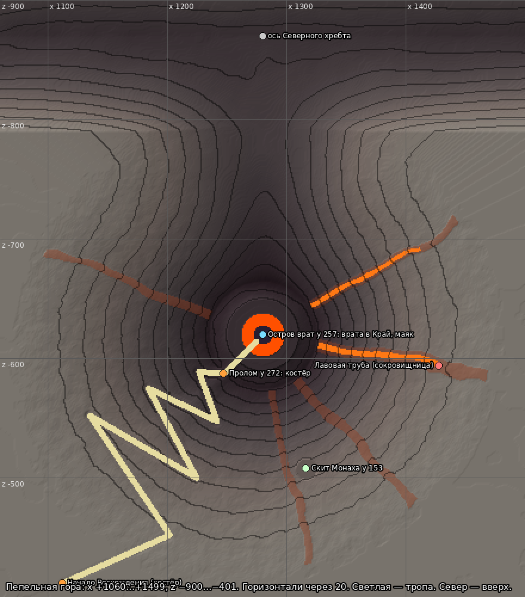

# The Last Ember · Карточки локаций Р6, партия 4

Oct 21, 2026 · Архитектор → Штаб

Р6, партия 4 из 4 — закрытие региона: Пепельная гора (карта высот), Скит Пепельного Монаха, врата в Край с пирамидой маяка, сокровищницы, мечи павших Несущих, схема костров Р6. Банды в Р6 нет (решено Штабом).

---

## 1. Пепельная гора · Р6

**Роль.** Ориентир региона и финальное восхождение. Тропа от Задних ворот Города к кратеру, на дне кратера — Остров врат.

**Положение и форма** — карта высот: [`../heightmaps/Пепельная гора.md`](../heightmaps/Пепельная%20гора.md). Центр (+1280, −620), подножие r ~200, гребень кратера y 280–294, Пролом y 271, лавовое озеро y 253, Остров врат y 257. Северный склон седловиной сливается с Северным хребтом.

**Образ.** Чёрный конус, который вырастает из пепла и упирается в Стену мира. Склоны исполосованы рыжими языками застывшей лавы, по двум потокам на востоке лава ещё течёт. Наверху — дым, и ночью гребень светится снизу. Внутри кратера — озеро огня, а посреди него — маленький остров с кольцом из камней Края и пустой пирамидой. Отсюда, с самой высокой точки мира, видно всё, что прошли.

**Структура по частям.**

1. **Тропа Восхождения** — серпантин в 7 колен по юго-западному склону, ~536 от подножия до Пролома. Полотно 5, со стороны обрыва местами бортик из `blackstone_wall`, местами ничего. На поворотах — каменные вешки с черепами, как на Тракте.
2. **Полка** (+1224, −500), y 144 — площадка на конце 3-го колена: костёр, обзор на Город и Пустошь. Отсюда тайная тропа к Скиту (карточка 2).
3. **Опасности склона:** пепельные «лавины» на 4-м и 6-м коленах (предложение) — со склона над тропой сыплется порошок бетона (swap полосы над тропой на `falling_block`, с предупреждением — гул и частицы за 2 секунды), может столкнуть с тропы. Элитная нежить и ведьмы — до Полки; выше — огненные духи из живых потоков (2–3, спавн датапаком у русла).
4. **Пролом** (+1247, −587), y 271 — вырез в гребне шириной ~12. Костёр. Вид внутрь кратера: озеро лавы, остров, пирамида.
5. **Пандус и дамба** — с Пролома вниз по стене кратера на дно (y 256), затем дамба шириной 5 через лаву к острову.
6. **Лавовая труба** — сокровищница на восточном склоне (раздел 4).

**Палитра** — в карте высот (материалы). Детали:

| Часть | Блоки и доли |
| --- | --- |
| Тропа | `polished_blackstone` 50%, `blackstone_slab` 20% (ступени), `cracked_polished_blackstone_bricks` 15%, `coarse_dirt` 15% (нижние колена) |
| Бортики, вешки | `blackstone_wall`, `polished_blackstone_wall`, `skeleton_skull` |
| Пандус, дамба | `polished_basalt`, `basalt`, края `magma_block` |

**Свой биом.** Предлагаю склоны и кратер оставить «Пепельной Пустошью», а кратер (r 45, все высоты) — отдельным вариантом: туман красный, частицы `lava`/`ash`, небо над кратером багровое. Решает реестр биомов.

**Свет.** Живые потоки и озеро — главный свет. Ночью гребень кратера подсвечен изнутри. Костры.

**Точки для механик.**

- Костры: Начало Восхождения (+1112, −412), Полка (+1224, −500), Пролом (+1247, −587).
- Пепельные лавины — 2 полосы swap над коленами 4 и 6 (предложение).
- Спавн огненных духов у живых потоков — 2 точки, не больше 3 живых.
- Падение в кратер мимо дамбы — лава, смерть, след в Урну.

**Пути.** Задние ворота Города → подножие → тропа → Полка (→ Скит) → Пролом → пандус → остров. Зона приключения: костры, Пролом, весь кратер (цилиндр r 45, y 250…300) с островом. Склоны разрушаемы.

**«Угасшая» версия.** Нет.

**Нагрузка.** Мобы: склон — ванильный спавн Пустоши; огненные духи — до 3. Блочные: 3 костра. Сущности: падающие блоки лавин (на 2–3 секунды).

**Технические заметки для Claude Code.** Рельеф — по карте высот. Пролом, остров, вешки — `.nbt`. Кратер — зона приключения целиком (металл в пирамиде).

**Референсы.** Рамки (Р6: Роковая гора; вулкан в восточном углу, на вершине врата в Край).

---

## 2. Скит Пепельного Монаха · Р6

**Роль.** Скрытый торговец Р6 (рамки). Последний человек на горе: он записывает имена тех, кто не дошёл.

**Положение.** (+1316, −508), y 153 — терраса r 9 на южном отроге, за застывшим потоком 170°. С тропы скит не виден: его закрывает поток и базальтовый столб.

**Габариты.** Терраса 18×18. Келья 7×6, часовня 5×7, высота 6–8. Часть врезана в скалу.

**Образ.** Келья, вырубленная в чёрном склоне, перед ней — маленький двор с каменной скамьёй и курильницей, из которой всегда поднимается дым. Стены кельи изнутри — сплошь исписаны именами: Монах пишет пеплом на камне всех, чей след попал в Урны. Сам он — старик в сером, пепел на плечах, и не уходит с горы, потому что «кто-то должен помнить».

**Структура по частям.**

1. **Тайная тропа** — от Полки (+1224, −500) на восток по горизонтали склона ~95: узкий карниз шириной 1–2, переход через застывший поток по базальтовой перемычке, за столбом — поворот к террасе.
2. **Двор** — скамья из `polished_blackstone_slab`, курильница — `campfire` на `hay_block` (высокий столб дыма, видный с тропы), в обводе `polished_blackstone_wall`.
3. **Келья** — врезана в скалу: лежанка, стол с книгами, сундук Монаха, стены — `smooth_basalt` с «именами» (таблички `dark_oak_wall_sign`/`crimson_wall_sign` с именами павших — предложение: датапак дописывает на табличку имена игроков, чьи следы ушли в Урны).
4. **Часовня** — ниша с алтарём, на алтаре — меч павшего Несущего, которого Монах принёс снизу (лор), и свечи.

**Палитра.**

| Часть | Блоки и доли |
| --- | --- |
| Келья, часовня | `smooth_basalt` 40%, `polished_basalt` 20%, `blackstone` 20%, `polished_blackstone_bricks` 20% |
| Крыша (выступающая часть) | `deepslate_tile_stairs`, `blackstone_slab` |
| Двор | `polished_blackstone`, `gray_concrete_powder` по краям |
| Убранство | `candle` (белые, серые), `lectern`, `bookshelf`, `chiseled_bookshelf`, `campfire` (дым) |

**Свет.** Свечи в часовне, фонарь у двери, курильница.

**Точки для механик.** Торговец (Монах); сундук Монаха; таблички имён (предложение); курильница — столб дыма как подсказка с тропы.

**Пути.** Полка → карниз → Скит → обратно. Зона приключения — терраса с кельей и фундаментом (y 145…165).

**«Угасшая» версия.** Нет.

**Нагрузка.** Торговец, 1 сундук, 4–6 табличек.

**Идеи для игры (предложения).**

- Подсказки к Скиту: карта Перевозчика с отметкой (партия 3); столб дыма над отрогом виден с 3-го колена тропы.
- Монах знает Город: «Они не злые. Они просто устали». Знает и Советчика, но молчит о нём: «Спросите его сами, у Кузни».
- Товар — решает Штаб (по смыслу: зелья огнестойкости, свечи, что-то для последнего боя).
- Монах говорит, сколько Несущих прошли мимо него. Если в Урнах игроков есть следы — «Я записал и вас. Простите, я спешил».

**Технические заметки.** 1 кусок `.nbt` 18×14×12. Таблички имён — `text_display` или таблички, обновляются из storage Урн (T-007).

**Референсы.** Рамки (скрытые торговцы: Пепельный Монах — скит на склоне Пепельной горы).

---

## 3. Врата в Край · Р6, выход к финалу

**Роль.** Выход из Р6 в финал. Звезда Незера становится маяком на пирамиде, луч открывает врата (решено Штабом).

**Положение.** Остров врат (+1280, −620), r 8, y 257, посреди лавового озера в кратере. Подход — дамба с юго-запада.

**Габариты.** Остров 17×17. Пирамида маяка 3×3 (уровень 1) + маяк. Кольцо врат — рамка портала Края 5×5 (внутри 3×3).

**Образ.** Кольцо из двенадцати камней Края с пустыми глазницами на крохотном острове посреди огня. Рядом — ступенчатая пирамидка из золота и железа с пустой вершиной. Всё готово, не хватает только одного — сердца. Когда маяк загорается, луч уходит в багровое небо, и глазницы кольца загораются одна за другой, по кругу, пока внутри кольца не откроется чёрная звёздная бездна.

**Структура по частям.**

1. **Дамба** — с юго-запада, ширина 5, выходит на остров.
2. **Пирамида маяка** — на юго-западной половине острова, у дамбы: 3×3 из `gold_block` и `iron_block` в шахматку, на вершине — пьедестал для звезды (до события — пусто, над ним 2 блока воздуха).
3. **Кольцо врат** — на северо-восточной половине: 12 блоков `end_portal_frame` по кругу (рамка 5×5 без углов), глаза пустые. Внутри 3×3 — до события пусто (лава под островом не видна — пол из `obsidian`).
4. **Край острова** — `obsidian` и `crying_obsidian`, по кругу 4 столбика с `chain` к лаве (декор).

**Событие (предложение).** Игрок с звездой Незера кликает по пьедесталу пирамиды. Звезда исчезает, на пирамиде появляется маяк (`beacon`), над ним — оранжевое стекло (`orange_stained_glass`): луч цвета последнего огня. Гул, вулкан «выдыхает» (частицы лавы и дыма над кратером). Глаза кольца загораются по одному (`end_portal_frame[eye=true]`), раз в 0,5 секунды, по кругу. Когда горят все 12 — внутри кольца появляется портал Края (`end_portal`). Вход в портал — перенос скриптом в Край (как все порталы карты). Луч маяка виден издалека — первый настоящий свет в Р6.

**Палитра.**

| Часть | Блоки |
| --- | --- |
| Остров | `obsidian` 50%, `crying_obsidian` 20%, `blackstone` 30% |
| Пирамида | `gold_block`, `iron_block`, пьедестал `chiseled_polished_blackstone` |
| Маяк | `beacon`, сверху `orange_stained_glass` |
| Кольцо | `end_portal_frame` ×12, после события — `end_portal` 3×3 |

**Свой биом.** Как кратер (раздел 1).

**Свет.** До события — только лава. После — луч маяка и свет портала.

**Точки для механик.** Пьедестал звезды (над ним 2 воздуха); маяк; 12 рамок (swap по одной); объём портала 3×3 — перенос в Край; триггер-зона острова.

**Пути.** Дамба ↔ остров. После события — портал в Край (финал). Зона приключения — весь кратер.

**«Угасшая» версия.** Нет: портал остаётся открытым (как Рамка Предков).

**Нагрузка.** Блочные: маяк, 12 рамок. Сущности: `interaction` у пьедестала.

**Идеи для игры (предложения).**

- Обратный путь из финала (если нужен) — тот же портал или шорткат; решает Штаб с финалом.
- Перед порталом Советчик может ждать у пирамиды (он появляется у главных костров) — последний разговор перед Кузней.

**Технические заметки для Claude Code.**

- `end_portal` в Верхнем мире ванильно переносит в Край на стандартную платформу — перехватывать и переносить скриптом в нашу точку (рамки).
- Маяк должен видеть небо: над пирамидой ничего, кроме стекла.
- Металл и маяк — в неразрушимой зоне (решено Штабом). Эффект маяка уровня 1 игрок может выбрать в меню маяка — предлагаю не мешать (бонус на последнем шаге), или оставить без эффекта: решает Штаб.
- Остров — 1 кусок `.nbt` 17×17×10.

**Референсы.** Ответ Штаба на Р6 п2 (звезда = маяк, луч открывает врата); ванильная рамка портала Края.

---

## 4. Сокровищницы Р6

Четыре: одна в Незере, три в верхнем мире.

### 4.1. Утонувшая колокольня (Мёртвые Топи)

Карточка — партия 3. Хозяин Утопленный Звонарь, вход через проём колокольни, сундук за алтарём часовни.

### 4.2. Багровая Утроба (Незер)

- **Положение.** Багровый лес, около (−150, −180), Незер, y 40–75. В стороне от пути к Крепости, ~120 к северо-западу от входного портала.
- **Вход.** Исполинский багровый гриб высотой ~35, шляпка r 12. Ствол полый: вход — между корнями у основания, под завесой плакучих лоз.
- **Логово.** Внутри ствола — спиральный подъём по наростам (`shroomlight`, `nether_wart_block` полки) в шляпку. Шляпка изнутри — гнездо 20×20: кости, лежанки из `crimson_roots`.
- **Хозяин.** Вепрь-Отец — элитный хоглин (`scale` ~1,8), с ним 2 молодых хоглина. Бьёт подбрасыванием — опасно у края полок внутри ствола.
- **Сундук.** В гнезде, в центре шляпки.
- **Подсказки.** Следы и обглоданные кости у тропы к Крепости; на рынке Бастиона — записка (картинками): гриб и перечёркнутый пиглин.
- **Палитра.** `crimson_stem`, `crimson_hyphae`, `nether_wart_block`, `shroomlight`, `weeping_vines`, `bone_block`.
- **Пути.** Корни → ствол → шляпка, назад тем же путём (или спрыгнуть в лозы). Зона приключения — гриб целиком.

### 4.3. Обсидиановый кратер (Пустошь)

- **Положение.** (+1180, +120), Пепельная Пустошь, один из пепельных кратеров (партия 3), r 14. Под ним — пещера, y 50–70.
- **Вход.** Дно кратера треснуло: в центре — провал 3×3, затянутый «коркой» из `magma_block`. Вниз — 12 блоков, на выступы.
- **Логово.** Грот 24×20, освещённый лавовыми лужами, стены — `obsidian` и `crying_obsidian` (застывшая кровь упавшей искры солнца).
- **Хозяин.** Плавильня — элитный лавовый куб огромного размера. При гибели распадается на обычные (ванилла), последний распад — без лута, чтобы не превращать в ферму сливок.
- **Сундук.** В нише за лавовой лужей, к нему — по двум камням.
- **Подсказки.** На Тракте записка мародёра: «Под одним из стеклянных кратеров — пустота. Слышно, как там булькает». Из провала — частицы дыма и жар (звук лавы).
- **Палитра.** `obsidian`, `crying_obsidian`, `blackstone`, `magma_block`, `lava`.
- **Пути.** Вниз — по выступам; вверх — по `chain` из провала (одна, свисает с края). Зона приключения — грот.

### 4.4. Лавовая труба (Пепельная гора)

- **Положение.** Вход (+1428, −594), y ~105, восточный склон, у живого потока 100°. Труба ~80 вглубь горы, y 100…120, на запад.
- **Вход.** Устье трубы — арка застывшей лавы над живым потоком: идти по краю русла.
- **Логово.** Труба 5–7 в поперечнике, по дну течёт лава, вдоль — полки. В конце — Сердце трубы: зал 20×16, высота 12, лавопад со свода.
- **Хозяин.** Матерь Огней — элитный огненный дух (`scale` ~2), вокруг — 2 обычных, появляются заново раз в 15 секунд, пока Матерь жива.
- **Сундук.** На островке посреди лавопада — к нему через полки.
- **Подсказки.** Монах: «Там, где лава уходит в гору, живёт та, что её зажигает». Живой поток ведёт прямо к устью.
- **Палитра.** `basalt`, `smooth_basalt`, `magma_block`, `blackstone`, `lava`.
- **Пути.** Устье ↔ зал. Зона приключения — труба и зал.

---

## 5. Мечи павших Несущих Р6

| Меч | Где | Образ | Размер |
| --- | --- | --- | --- |
| На острове посреди моря | Незер, (0, 0), y ~40 | Отряд прошёл первый мост и остановился на острове. Меч наполовину оплавлен, стоит в базальте; вокруг — обугленные щиты. Первое, что видно с Западного моста | 12 |
| У трещины на Тракте | (+815, −140) | Обоз Несущих шёл к Городу «за светом». Меч вбит у края лавовой трещины, рядом перевёрнутая телега | 10 |
| Перед Мостом Бледных Цветов | (+850, −290) | Один не вошёл в Город. Меч воткнут лицом к воротам, на гарде — повязка, которой завязывают глаза | 12 |
| Ниже Пролома | (+1236, −585), y 265 | Последний отряд. Они дошли до гребня и увидели пустую пирамиду. Меч смотрит в кратер | 16 |

---

## 6. Схема костров Р6

Р6 — два пространства: Незер и Пепельные Земли.

| № | Костёр | Координаты | y | Заметка |
| --- | --- | --- | --- | --- |
| 1 | Вход в Незер | Незер (−180, 0) | ~70 | Вход в регион (портал Рамки Предков) |
| 2 | Ворота Крепости | Незер (+50, −70) | ~55 | |
| 3 | Перед Залом Пепла | Незер (+50, −146) | ~60 | Перед ареной Кастеляна |
| 4 | Вход в Бастион | Незер (+180, +95) | ~40 | Перед Свиным Королём |
| 5 | Перед Котлом | Незер (+205, +10) | ~36 | Перед ареной Пепельного Духа |
| 6 | Выходной портал | Незер (+370, +40) | ~45 | Перед Наковальней |
| 7 | Пепельные Врата — главный | (+760, 0) | по рельефу | Урна Р6, дверь шортката |
| 8 | Топи | (+900, +255) | по рельефу | Необязательная петля |
| 9 | Ворота Города | (+860, −300) | по рельефу | |
| 10 | Перед Цитаделью | (+1040, −300) | по рельефу | Перед Башней |
| 11 | Начало Восхождения | (+1112, −412) | 80 | После побега из Города |
| 12 | Полка | (+1224, −500) | 144 | Поворот к Скиту |
| 13 | Пролом | (+1247, −587) | 271 | Последний перед Краем |

| Путь | Примерно |
| --- | --- |
| (1) → (2) по мостам | 275 |
| (2) → (3) через двор | 80 |
| (3) → (4) обратно к морю и на юг | 290 |
| (4) → (5) через Бастион | 120 |
| (5) → (6) через Котёл и восточный мост | 170 |
| (6) → Наковальня | 140 |
| (6) ↔ (7) | портал |
| (7) → (9) по Тракту | 320 |
| (7) → (8) к Топям | 260; из Топей к Городу ~600 по гатям и Пустоши |
| (9) → (10) через город | 180 |
| (10) → (11) через Задние ворота | 135 |
| (11) → (12) по тропе | 320 |
| (12) → (13) по тропе | 215 |

**13 костров: 6 в Незере, 7 наверху.** Это больше, чем 6–8 у других регионов, но Р6 — два региона в одном, и каждая арена (Кастелян, Король, Дух, иссушитель, Хранитель) требует костра перед собой. Если нужно сократить — можно убрать (3) (до Зала от (2) всего 80) и (8) (Топи — петля, от Врат 260).

**Шорткат.** Дверь шортката Р6 — в Пепельных Вратах у главного костра (партия 1).

---

## Открытые вопросы

1. **13 костров** — оставить или сократить до 11 (без «Перед Залом» и Топей)?
2. **Пепельные лавины** на тропе — берём?
3. **Событие врат** — 12 глаз загораются по кругу, портал Края в кольце. Подходит?
4. **Таблички имён у Монаха** — имена игроков из Урн. Берём, если билдеру не тяжело?
5. **Кратер** — свой вариант биома (красный туман) или оставить Пустошь?
