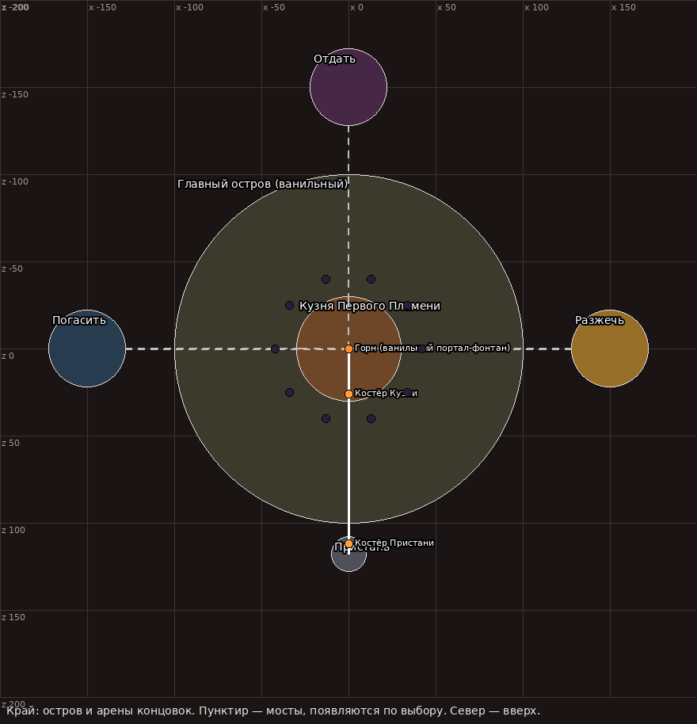

# The Last Ember · Карточки локаций Финал, партия 1

Oct 21, 2026 · Архитектор → Штаб

Финал: Кузня Первого Пламени в Краю. Последняя партия карты. Шесть карточек: раскладка Края и Пристань, остров и бой с драконом, Кузня Первого Пламени, три арены концовок (одной карточкой — у них общий каркас), разрушенный город Края (эпилог), путь обратно и Приют после концовки.

Координаты — Края. Остров Края — ванильный (генерация измерения), мы строим на нём и вокруг него.

## Раскладка Края

| Часть | Где (x, z) | y | Что |
| --- | --- | --- | --- |
| Пристань | (0, +118), r 10 | ~60 | Точка прибытия из врат Пепельной горы. Костёр Пристани |
| Главный остров | (0, 0), r ~100 | 55–70 | Ванильный: `end_stone`, 10 обсидиановых столпов с кристаллами на r 42 |
| Кузня Первого Пламени | (0, 0), r 30 | ~62 | Руины кузни вокруг ванильного фонтана-портала. Костёр Кузни (0, +26) |
| Арена «Разжечь» | (+150, 0), r 22 | ~64 | Восток — там, где вставало солнце |
| Арена «Погасить» | (−150, 0), r 22 | ~60 | Запад — там, где оно садилось |
| Арена «Отдать» | (0, −150), r 22 | ~66 | Север — за спиной у Кузни, куда не смотрят |
| Разрушенный город Края | внешний остров, около (+1100, +250) | по острову | Эпилог, необязательный |

**Путь.** Врата на вершине Пепельной горы → Пристань → мост на остров → бой с драконом → Кузня → выбор (Уголь в одно из трёх лож) → мост к арене выбранной концовки → арена → путь обратно в Приют. Эпилог — через ванильные врата Края (после концовки).

---

## 1. Пристань · Финал

**Роль.** Точка прибытия, первый вид на остров. Костёр перед ареной дракона.

**Положение.** (0, +118), y ~60, парящая площадка у южного края главного острова, от неё к острову — мост ~20.

**Габариты.** Площадка r 10 + мост 3×20.

**Образ.** Игроки выходят из чёрного портала на каменный причал, висящий в пустоте. Неба нет — только чернота. Впереди — бледный остров, кольцо чёрных столпов, на вершинах которых горят кристаллы, и в центре — красный отсвет. Над островом кружит дракон. Позади — ничего: пустота, из которой пришли.

**Структура по частям.**

1. **Площадка** — круг r 10 из `end_stone_bricks` и `obsidian`, днище конусом вниз на 12 (висит в пустоте).
2. **Рамка прибытия** — арка из `obsidian` и `crying_obsidian` без портала: место, где «выходят» (перенос скриптом с Пепельной горы).
3. **Костёр Пристани** (0, +112) — у основания моста.
4. **Мост** — 3×20 из `end_stone_brick_slab` и `purpur_pillar` перилами, с провалами в 1 блок (не опасно, но страшно).
5. **Меч павших Несущих** — один: тот, кто дошёл до Края и дальше не смог. Вбит у основания моста лицом к острову. Последний меч карты.

**Палитра.** `end_stone_bricks` 50%, `obsidian` 20%, `crying_obsidian` 10%, `purpur_block` 10% (потускневший — пятнами), `end_stone` 10%.

**Свет.** Костёр, кристаллы на столпах вдали, красный отсвет Горна.

**Точки для механик.** Точка прибытия (лицом к острову); костёр; меч.

**Пути.** Пристань → мост → остров. Зона приключения — площадка с мостом и днищем.

**Нагрузка.** Блочные: костёр.

**Технические заметки.** 1 кусок `.nbt` 21×21×16. Ванильная обсидиановая площадка прибытия (100, 49, 0) не используется — переносим на Пристань.

---

## 2. Остров и бой с драконом · Финал

**Роль.** Арена дракона Края — ванильный бой (рамки).

**Положение.** Ванильный главный остров, центр (0, 0). 10 обсидиановых столпов на r 42 — ванильные, с кристаллами (два в клетках).

**Образ.** Остров, на котором ковали солнце. Столпы — это опоры: от их вершин к центру тянулись цепи, на которых висел горн. Теперь цепи оборваны, свисают обрывками со столпов, а на острове между столпами лежат обломки огромных инструментов — клещи, молот, кусок наковальни, — каждый размером с дом. Кристаллы на столпах — последние искры, которые питают дракона.

**Структура по частям.**

1. **Столпы** — ванильные. Добавить: обрывки цепей (`chain`, 6–12 блоков) с вершин внутрь, на 4–5 столпах; у подножия столпов — кольцо `obsidian`-обломков.
2. **Обломки инструментов исполинов** — 3 крупных объекта на острове между столпами и Кузней (укрытия от дыхания дракона):
   - **Клещи** — две скрещённые балки `polished_blackstone` 3×3×24, у (+60, −30);
   - **Молот** — головка 9×9×12 из `polished_basalt` с поясом `gilded_blackstone` и рукоять 3×3×30, лежит наискось, у (−55, +40);
   - **Обломок наковальни** — 14×8×9 из `polished_deepslate`, у (−40, −60).
   Исполины — первые Несущие (лор): это их инструменты.
3. **Остальной остров** — ванильный, разрушаемый (`end_stone` можно копать, чтобы строиться к клеткам кристаллов).

**Бой.** Ванильный дракон. Кристаллы сбивать луком или забираться по столпам. Мы ничего не меняем в механике боя (рамки). `mob_griefing false` (T-004): дракон не ломает блоки — проверить, что это касается и его пролёта через постройки (ванилла: дракон ломает блоки при `mob_griefing true`).

**Палитра.** Ванильная + обломки (выше).

**Свет.** Кристаллы, лучи кристаллов к дракону, Горн в центре.

**Точки для механик.** Костёр Пристани — перед ареной. Падение в пустоту — смерть, след в Урну (какую — вопрос 4).

**Пути.** Весь остров открыт. Зона приключения — только Кузня (карточка 3), обломки, Пристань.

**«Угасшая» версия.** После боя: столпы пусты, кристаллов нет (ванилла).

**Нагрузка.** Ванильный бой: дракон, 10 кристаллов.

**Технические заметки.** Обломки — 3 куска `.nbt`. Проверить: при `mob_griefing false` дракон пролетает сквозь блоки, не ломая их, — тогда обломки и Кузня безопасны.

---

## 3. Кузня Первого Пламени · Финал

**Роль.** Сердце финала. Место выбора: три ложа для Угля, мосты к трём аренам концовок. Костёр Кузни — перед аренами.

**Положение.** Центр острова (0, 0), круг r 30, y ~62. В центре — ванильный фонтан-портал (выход из Края), появляется в игре сам.

**Габариты.** Круг 60 в диаметре. Стены руин до 12, Горн — ванильный фонтан 7×7 + наша чаша вокруг r 8.

**Образ.** Кузня под открытым чёрным небом: круг разбитых стен, кольцо наковален, по которым когда-то били молоты исполинов. В центре — Горн: каменная чаша, в которой спит огонь, и над ним, на тонкой игле, сидит яйцо дракона. Когда дракон падает, Горн просыпается. Вокруг Горна — три ложа, каждое смотрит на свой мост: огонь, вода, рука.

**Структура по частям.**

1. **Горн.** Ванильный фонтан (бедрок, 7×7, игла с яйцом) — ядро. Вокруг — наша чаша r 8: стенка из `polished_blackstone_bricks` высотой 2, внутри — `magma_block`. Ванилла после смерти дракона заполняет фонтан порталом Края; скрипт сразу заменяет портал на `lava` (огонь Горна проснулся, выхода через фонтан нет — выход отдельно, карточка 6).
2. **Кольцо наковален** — 6 наковален исполинов по r 18: блоки 5×3×4 из `polished_deepslate` и `anvil`/`damaged_anvil` на верхушках. Две расколоты.
3. **Руины стен** — кольцо r 26–30, высота 4–12, с проломами на восток, запад, север (к аренам) и юг (к Пристани).
4. **Три ложа** вокруг Горна, на r 12 — каждое у пролома к своей арене:
   - **Восток — Ложе Огня** («Разжечь»): чаша на подставке-наковальне, в чаше — `gilded_blackstone`, над ней — пустая клетка из `iron_bars`;
   - **Запад — Ложе Воды** («Погасить»): каменная купель с чёрной водой, края `calcite`;
   - **Север — Ложе Руки** («Отдать»): раскрытая каменная ладонь из `smooth_quartz` и `quartz_bricks`, высотой 4.
5. **Мосты к аренам** — до выбора их нет: за проломами — пустота. Мост выбранной арены «нарастает» из пустоты (swap по отрезкам за 10–15 секунд).
6. **Костёр Кузни** (0, +26) — у южного пролома.

**Выбор.** Носитель Угля кладёт его в одно из лож. Это необратимо: ложе запирает Уголь, к арене поднимается мост, два других ложа гаснут. Остальные игроки идут с носителем.

**Палитра.**

| Часть | Блоки и доли |
| --- | --- |
| Стены | `end_stone_bricks` 35%, `polished_blackstone_bricks` 25%, `obsidian` 15%, `cracked_polished_blackstone_bricks` 15%, `purpur_block` 10% (выцветшие вставки) |
| Пол | `polished_blackstone` 50%, `end_stone_bricks` 30%, `obsidian` 20% |
| Наковальни | `polished_deepslate`, `anvil`, `damaged_anvil` |
| Ложа | огонь — `gilded_blackstone`, `iron_bars`; вода — `calcite`, `water`; рука — `smooth_quartz`, `quartz_bricks` |
| Горн | ванильный бедрок + `polished_blackstone_bricks`, `magma_block`, после события — `lava` |

**Свой биом.** Предлагаю для всего Края свой вариант: небо — абсолютно чёрное (без ванильной текстуры неба Края, если это делается атрибутом или биомом; иначе — вопрос 5), туман чёрно-фиолетовый, частицы — редкие искры (`small_flame`/`ash`), музыка финала (слот Штаба).

**Свет.** До дракона — магма Горна (тускло). После — лава Горна, и над ним искры. Ложе выбранной концовки загорается своим светом (огонь — тёплый, вода — `soul`, рука — белый).

**Точки для механик.** Три ложа (над каждым 2 воздуха); 3 моста — swap по отрезкам; замена ванильного портала фонтана на лаву; костёр Кузни.

**Пути.** Пристань → Кузня → (выбор) → мост к арене. Зона приключения — круг Кузни r 30 с фундаментом (весь остров под ней до y 40).

**«Угасшая» версия.** Нет: после концовки остров остаётся тем, что сделала концовка (карточка 6).

**Нагрузка.** Сущности: 3 `interaction` у лож; Уголь в ложе — `item_display`. Блочные: костёр.

**Технические заметки.**

- Фонтан Края ванилла строит сама (при генерации и снова после смерти дракона) — наши блоки не должны пересекаться с ним (7×7 в центре + игла): чаша — снаружи.
- Яйцо дракона — ванильное, наверху иглы. Пусть будет: трофей, который можно взять (решает Штаб).
- Руины — 4 куска `.nbt` по четвертям 32×32×16.

**Референсы.** Рамки (Финал: остров, где ковали солнце; столпы, разрушенная кузня в центре, чёрное небо без звёзд).

---

## 4. Арены концовок · Финал

**Роль.** Три небольшие арены (M), по одной на концовку (рамки). На каждой — последний бой и событие концовки. Сюжет и ход боя — за Штабом; ниже — пространство и предложения.

**Общий каркас.** Парящий остров r 22 в пустоте, ~150 от центра. Мост 3 шириной с острова Кузни (130 длиной) появляется только после выбора. Днище каждого острова — конус до y ~20 (видно с главного острова: три тёмных «висящих камня» на горизонте с самого начала — игроки видят их и гадают).

### 4.1. «Разжечь» — Наковальня Солнца (восток, +150, 0)

**Образ.** Остров-наковальня: плоский верх, рог на восток. В центре — круглая наковальня 9×9, на которую кладут Уголь. Вокруг — 8 зеркальных пластин (столбы из `gold_block` и `glass`), развёрнутых к центру. На восточном краю обрыв — и под ним, далеко внизу, тусклое красное пятно: то, что осталось от солнца.

**Событие (предложение).** Носитель ставит Уголь на наковальню и встаёт рядом — он должен быть с Углём (стоять на наковальне) всё время. Уголь растёт: 3 стадии (размер `item_display`, свет, звук), 3–4 минуты. Из пустоты на остров поднимаются «угасшие» — тени павших Несущих (элитная нежить), они идут к носителю: остальные защищают. В конце носитель вспыхивает и уходит в Уголь — «ценой носителя» (рамки): игрок переходит в наблюдатели над солнцем. Снизу из пустоты поднимается солнце — огромный светящийся шар (`item_display` с моделью), небо Края светлеет.

**Палитра.** `gold_block` 15%, `gilded_blackstone` 20%, `polished_blackstone` 30%, `end_stone_bricks` 25%, `shroomlight` 10% (светится к финалу).

### 4.2. «Погасить» — Чаша Тишины (запад, −150, 0)

**Образ.** Остров-чаша: края приподняты, в центре — круглое озерцо чёрной неподвижной воды r 6. Вокруг озера — 12 стел с именами (имена павших Несущих: имена с мечей по всем регионам и имена игроков из Урн — рифма к табличкам Монаха). Тишина, единственный звук — капли.

**Событие (предложение).** Носитель опускает Уголь в воду. Уголь не хочет гаснуть: из воды поднимается **Последнее Пламя** — огненный дух-исполин (элитный, `scale` ~2,5), пламя Угля в последней попытке выжить. Бой у воды: Пламя испаряет воду кругами (swap воды на `magma_block` и обратно), игроки бьют его, когда он над водой. Победа — Уголь гаснет. Тогда со стел одно за другим поднимаются имена — огоньки (`soul`), и уходят вверх: мёртвые свободны. Носитель выживает. Небо остаётся чёрным, но в нём впервые появляются звёзды (если можно — иначе частицы-«звёзды» над островом).

**Палитра.** `calcite` 30%, `end_stone_bricks` 30%, `polished_deepslate` 20%, `tinted_glass` 5%, стелы — `polished_deepslate` с `chiseled_deepslate`, вода — биома Края (чёрная).

### 4.3. «Отдать» — Престол Взгляда (север, 0, −150)

**Образ.** Остров снизу — огромное каменное лицо, обращённое вниз, в пустоту; видно с главного острова как «висящая голова». Наверху — площадка на макушке, престол из `smooth_quartz`, и в стенах вокруг — десятки маленьких лиц, тех же, что игроки видели всю игру в стволах, скалах и под водой. На престоле ждёт Советчик, как всегда, с трубкой.

**Событие (предложение).** Носитель отдаёт Уголь Советчику. Советчик берёт его — и все лица на острове открывают глаза (`verdant_froglight` в глазницах, swap), лицо-днище поворачивает взгляд вверх. «Мир смотрит» раскрывается (рамки: намёки раскрываются только в «Отдать»). Что дальше — бой или нет — решает Штаб. Предложение: Советчик предлагает команде остаться «смотреть вместе с ним»; бой — со «стражами взгляда» (элитные эндермены, «Безликие»), которые выходят из лиц, пока Советчик пьёт огонь Угля. В тот же миг в Приюте рушится шестая ниша (карточка Р0, решение Штаба): исполин за ней — без шара на плечах.

**Палитра.** `smooth_quartz` 25%, `quartz_bricks` 15%, `end_stone_bricks` 30%, `obsidian` 20%, лица — `chiseled_quartz_block`, `polished_blackstone`, глаза — `verdant_froglight` (открытые) / `polished_blackstone` (закрытые).

**Общее для трёх.**

- **Свет.** Каждая арена — в своём свете (тёплый / синий / белый), остальное — чернота.
- **Точки для механик.** Центр события (наковальня / озеро / престол); 6–8 точек появления врагов по краю; swap-шаблоны событий; точка выхода (карточка 6).
- **Пути.** Мост из Кузни → арена → выход. Зона приключения — вся арена с днищем.
- **Нагрузка.** Мобы — до 4 на живого игрока одновременно (как гарнизон Города), босс 1. Сущности — `item_display` для Угля и солнца.
- **Технические заметки.** Каждая арена — 2 куска `.nbt` (верх 44×44×16, днище — скриптом конусом). Мосты — swap по отрезкам. Солнце «Разжечь» — `item_display` большого масштаба далеко внизу, поднимается `transformation` интерполяцией.

---

## 5. Разрушенный город Края · эпилог

**Роль.** Необязательный эпилог (рамки): небольшой разрушенный город Края с шулкерами. Место, где жили те, кто ковал солнце; последние записки, лут.

**Положение.** Внешний остров Края, около (+1100, +250), y по острову. Попасть — ванильными вратами Края (они появляются на r ~96 после смерти дракона), перенос скриптом в нашу точку.

**Габариты.** 60×60, 3 башни до 50, один мост-переход, корабль не строим (ванильный город выключен, T-001b).

**Образ.** Не сиреневый город ванильного Края, а выцветший: пурпур почти белый, башни надломлены, мосты оборваны. Это жилища кузнецов солнца, брошенные, когда огонь погас. В окнах — шулкеры, как стража, которая забыла, что охраняет.

**Структура.** 3 башни (две целые до половины, одна рухнула и лежит мостом к соседнему островку); мастерская у подножия с чертежами солнца на стенах (картины из блоков — круг, лучи); 3 сундука; на вершине главной башни — площадка с видом на главный остров и арены.

**Палитра.** `purpur_block` 30%, `purpur_pillar` 15%, `end_stone_bricks` 30%, `end_stone` 15%, `obsidian` 10%; свет — `end_rod`.

**Мобы.** Шулкеры 6–8, эндермены ванильные.

**Идеи (предложения).** Записки кузнецов: «Солнце нельзя разжечь заново. Можно только отдать ему кого-то» — подсказка для тех, кто пришёл сюда до выбора (если эпилог открыт до концовки). Награда — снаряды шулкеров (ванилла) и что-то из общего пула.

**Технические заметки.** 4–6 кусков `.nbt`. Ванильные врата — перехватить перенос в нашу точку (ванилла кидает к случайному внешнему острову).

---

## 6. Путь обратно и Приют после концовки

**Роль.** Выход из финала и «последний кадр» в Приюте.

**Предложение.**

- После события концовки на арене появляется портал (рамка из материала арены) → перенос скриптом на Главную площадь Приюта, к Главному Костру.
- **Приют меняется по концовке** (swap и `fillbiome`):
  - **«Разжечь»** — небо Приюта светлое, тёплое (вариант биома «Сумеречного Приюта» с дневным небом), Главный Костёр горит высоко. У Урны — имя носителя.
  - **«Погасить»** — небо тёмное, но в нём звёзды; Урна пуста, свечи на ней погасли сами (все следы ушли). Главный Костёр — тихий.
  - **«Отдать»** — шестая ниша рухнула (уже решено), на всех статуях в Зале — открытые глаза (`verdant_froglight`), у Главного Костра сидит Советчик и молчит.
- Край после концовки остаётся доступен через врата Пепельной горы (эпилог, обломки, арена). Вернуться в мир можно всегда — порталом с Пристани (новая рамка, появляется после концовки).

---

## Открытые вопросы

1. **Дракон** — ванильный бой без изменений (как в рамках) или усиленный (`scale`, здоровье по числу игроков)?
2. **Сюжет трёх концовок** — бои на аренах (тени у Наковальни, Последнее Пламя у Чаши, Безликие у Престола) — предложения; решение и тексты — за Штабом.
3. **«Ценой носителя»** в «Разжечь» — носитель уходит в наблюдатели до конца сессии? Или возвращается в Приюте «другим» (без Угля, со следом-шрамом)?
4. **Урна Края** — смерти в пустоте Края: следы в Урну Р6 (Пепельные Врата) или своя Урна у Пристани?
5. **Чёрное небо** — ванильное небо Края — текстура. Если атрибутом/биомом его не убрать, можно заменить текстуру неба Края в ресурс-паке (используется только в Краю, глобально ничего не перекрашивает). Разрешаете?
6. **Эпилог** — открыт сразу после дракона (тогда записки кузнецов — подсказка перед выбором) или только после концовки?
7. **Яйцо дракона** — трофей (можно взять) или часть Горна (неразрушимо)?
